# Interactive calculator tutor

**Branch:** `feature/interactive-calculator-tutor`, Draft PR #38. **Not for merge until the owner approves.**
**Status:** nothing written to Production. Production was only *read* (a snapshot of the 22 bank questions and 62 imported artifacts of math_book_3, kept in `lib/calculator-tutor/fixtures/math-book-3.json`). Every browser run used the isolated local database `calc_tutor_e2e` (recreated before each run) and a production build.

- **Phase 2 (this update):** every question whose imported solution contains a calculator method now gets a guide automatically. No question needs a configuration file.
- **Phase 1 (pilot, below):** the hand-checked x / ln x lesson, now kept as the reference and regression fixture.

**Final status (phase 2): READY FOR OWNER REVIEW**

---

# Phase 2: guides generated from the source, for every applicable question

## P2.1 Audit: what the data actually contains

| Source (Production, read only) | Count | With a calculator method |
|---|---|---|
| Bank questions (math_book_3, Dạng 1) | 22 | **3**: Câu 1 (x / ln x), Câu 2 ("tương tự bài 1"), Câu 20 ((2x − 3) / √(x² − 1)) |
| Imported SOLUTION artifacts | 36 | 4: the three above + Dạng 2 Câu 11 (sin, solution only: Dạng 2 is not in the bank) |
| Of which mention the calculator only to say it is not needed | 1 | Dạng 2 Câu 13: correctly **not** detected |

Every method found is **TABLE** (MODE 7). There is no SOLVE, CALC, derivative, integral or statistics method anywhere in the imported data, so those operations were built and tested on clearly labelled synthetic QA questions only. Typical source defects: screenshots referenced but not imported ("máy hiện như sau:" followed by nothing), missing range ("tương tự bài 1"), the wrong key for π/e, OCR damage (`rac{`, control characters), no angle unit before sin.

## P2.2 Architecture (no per-question code, no migration)

```
question (stem, options, explanation)
  └─ detect.ts      deterministic, Vietnamese, diacritic- and OCR-tolerant
                    → method present? operation, model named?, section, events (open table,
                      function, range, parameter, reference, read, conclusion, CALC result, keys),
                      OCR suspects, missing figures, confidence
  └─ generate.ts    → GuideStep[] with an origin on every step
                    SOURCE · CORRECTED · MODEL · FROM_QUESTION · PROPOSED · COMPUTED · MISSING · UNCERTAIN
                    level A: every step replayed on the simulator, every table value checked
                             against the formula (latex.ts); any mismatch → downgraded to B
                    level B: highlighted keys + values computed from the formula, no simulated screen
                    level C: text steps, gaps marked
                    warnings: info / review
  └─ registry.ts    content hash (stem + explanation + options) → cached guide
                    reference guides (x / ln x) matched by function + options, not by id
                    Admin decision stored on the question (calculatorGuideReview, inside the
                    existing question-bank JSON document: no table, no migration);
                    a content edit changes the hash and voids the decision
```

- Generation is pure and runs when the question is read (preparation, review, publication all see the same result). Nothing is generated at answer time per student, and no AI call is made: Gemini was not needed, so nothing untrusted enters the guide.
- The guide is attached on the server to the feedback of an answered question only, as in phase 1.
- A student sees a guide only if it has a level, Admin has not disabled it or chosen the original, and either it has no review warning or Admin accepted it.
- Model: only fx-570VN PLUS / fx-570ES PLUS are simulated. A source with no model and a TABLE method is taught on fx-570VN PLUS **with a visible note** ("Lời giải không ghi đời máy…"). A source naming another model (fx-580VN X, 570MS, Vinacal…) gets level B **without** highlighted keys.

## P2.3 Levels

| Level | When | Student sees |
|---|---|---|
| **A · Mô phỏng từng phím** | TABLE, function known, range known or proposed, every value verified | Phase 1 tutor: watch / practise, real screens, checkpoints |
| **B · Minh hoạ có hướng dẫn** | keys known but the operation (SOLVE, CALC, sin/cos/tan, other model) is not simulated | Step cards, keys lit on the keypad, values computed from the formula, panel labelled "Minh hoạ · không mô phỏng màn hình" |
| **C · Từng bước bằng lời** | the source has steps but no usable keys | Step timeline, missing/uncertain parts flagged |

No mandatory long key flow: level A can be watched (autoplay) instead of typed; B and C have "Tự chạy".

## P2.4 Coverage (`coverage.json`, generated by the unit test from the snapshot)

**Source coverage** (questions whose solution contains a calculator method): **3 / 22** bank questions (+1 solution-only source). Detection on all 58 sources against hand labels: **0 false positives, 0 false negatives** (small corpus, labels made during this audit).

**Simulator coverage** (of those 4 sources):

| Source | Operation | Level | Visible to students now | Why |
|---|---|---|---|---|
| Câu 1 x / ln x | TABLE | A (reference) | yes | hand-checked in phase 1; generator alone also reaches A and corrects SHIFT ×10ˣ → ALPHA ×10ˣ |
| Câu 20 (2x−3)/√(x²−1) | TABLE | A (generated) | yes | function from the stem, range from the source, 13 rows checked, 5 ERROR rows explained |
| Câu 2 | TABLE | A (generated) | **after Admin accepts** | source says only "tương tự bài 1": range proposed by Tú Tài, labelled "Tú Tài đề xuất" |
| Dạng 2 Câu 11 (sin) | TABLE | C now; **B** once imported with its stem | after Admin review | no stem in the bank; with the stem: values computed, Radian step added and flagged |

Totals: levels A = 3, B = 0, C = 1 on real data; needs Admin correction or acceptance: 1 (Câu 2), +1 when Dạng 2 is imported. Cannot be guided safely: 0. **This is not 100 % of anything**: it is full coverage of the small set of methods that exist.

**What prevents broader coverage:** only Dạng 1 (22 questions) is in the bank; the calculator screenshots were not imported, so ranges and readings often have to be proposed or computed; no SOLVE/CALC/derivative/statistics methods exist in the data yet; sin/cos/tan, CALC, SOLVE, ∫ and d/dx are not simulated (level B); real-device confirmation of the screens is still pending.

## P2.5 UI

- Student, after answering: "Cách 1: Lời giải toán học" (source text, verbatim) and "Cách 2: Thực hành bằng máy tính"; when the source has no other method, one section "Thực hành bằng máy tính". Level badge, origin badge on every step that is not plainly from the source.
- Level B/C share the phase 1 visual language (same card, progress bar, keypad, checkpoints). On a phone the keypad goes under the card and stays compact.
- Admin, in each question card of the lesson workspace: detected operation, model, steps, keys, confidence, whether students see it, review warnings, "Xem trước như học sinh", Chấp nhận, Sửa lời dặn (instructions only: keys and values cannot be edited by hand), Tắt hướng dẫn, Giữ lời giải gốc, Bỏ quyết định. Saved through the existing question PATCH route, with an audit entry.

## P2.6 Screenshots (real Chromium, production build, local QA database)

| # | State | 1440 × 900 (mouse) | 768 × 1024 (keyboard) | 390 × 844 (touch) |
|---|---|---|---|---|
| 1 | Câu 20, generated, feedback | 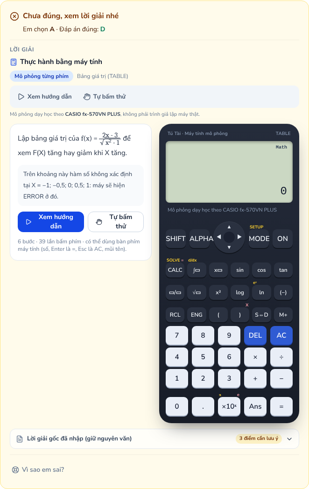 |  | 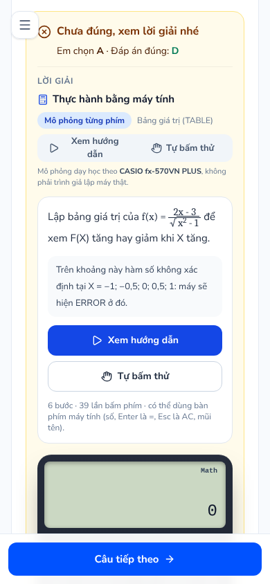 |
| 2 | Câu 20 demo, √ box | 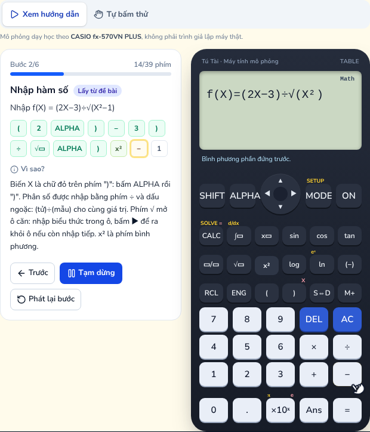 |  | 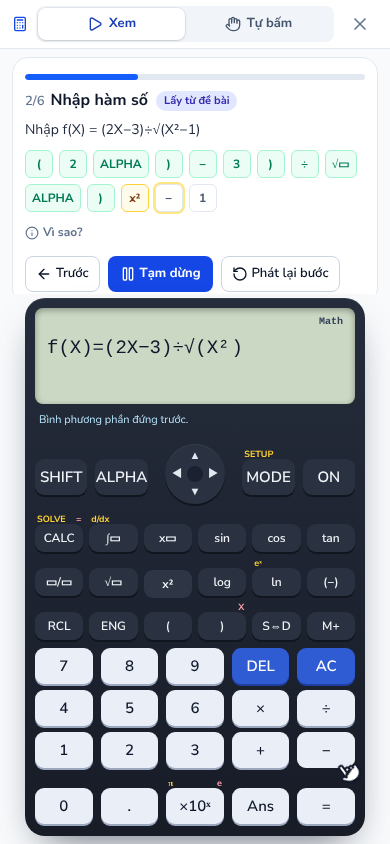 |
| 3 | ERROR rows explained |  | 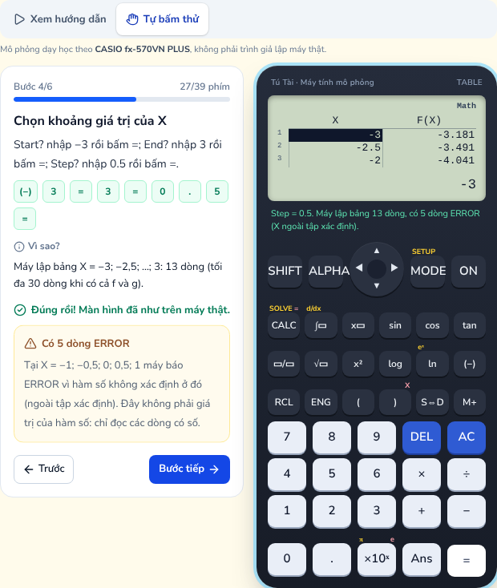 | 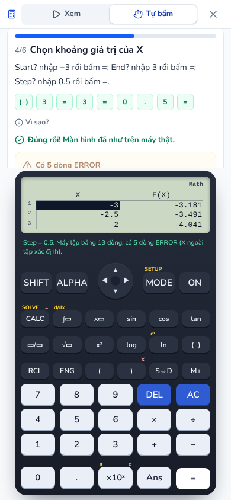 |
| 4 | Completion |  | 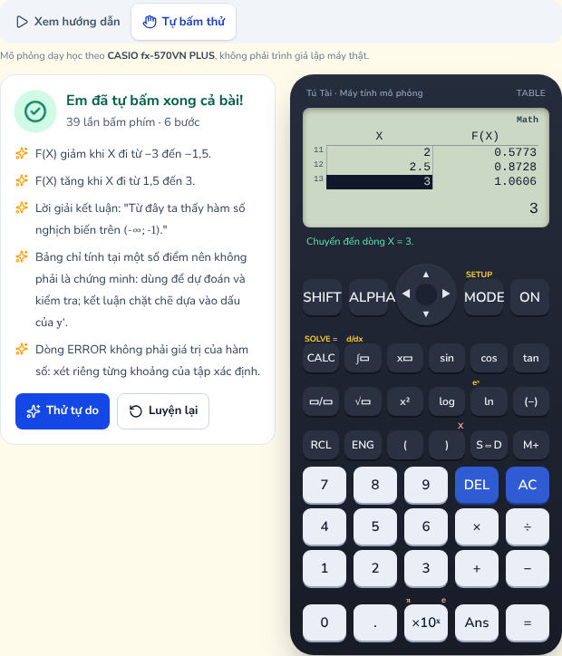 | 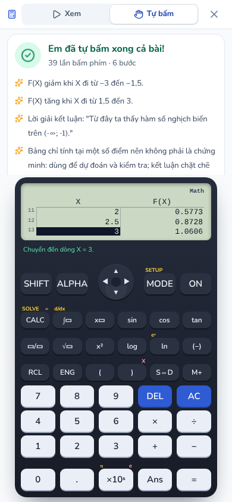 |
| 5 | SOLVE, level B illustration |  | 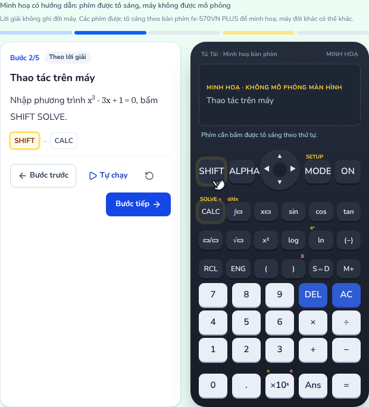 | 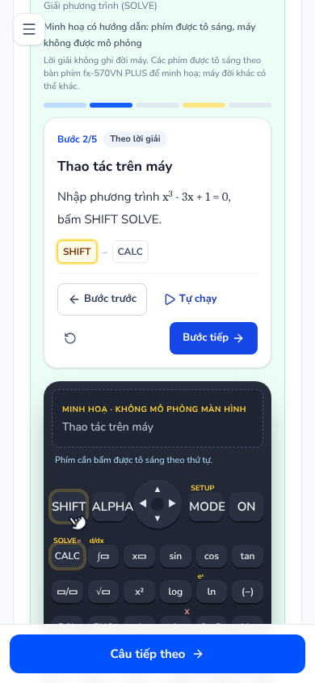 |
| 6 | Admin review panel | 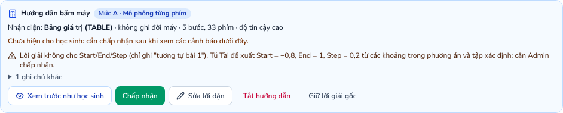 | 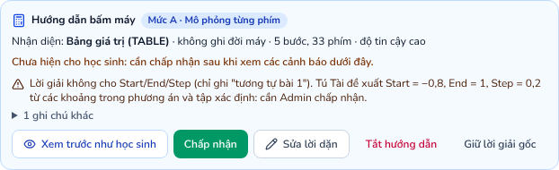 | 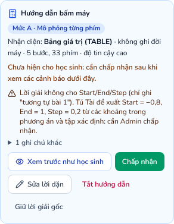 |
| 7 | Admin student preview | 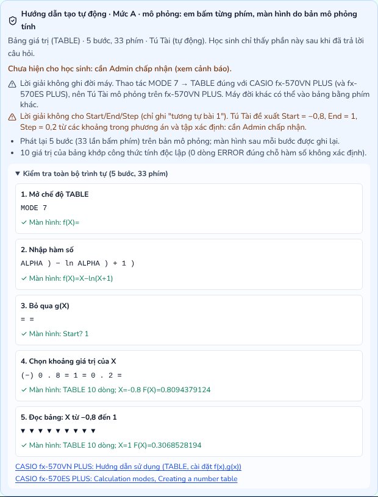 | 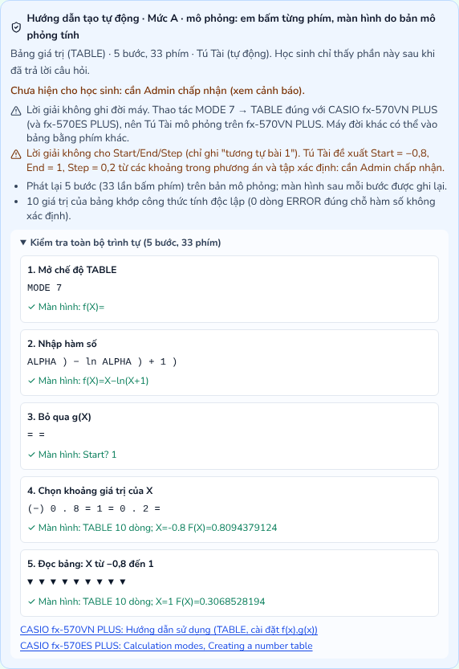 | 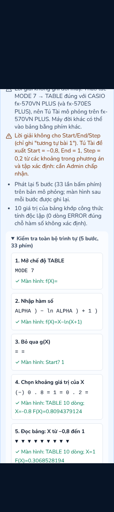 |
| 8 | Admin correction | 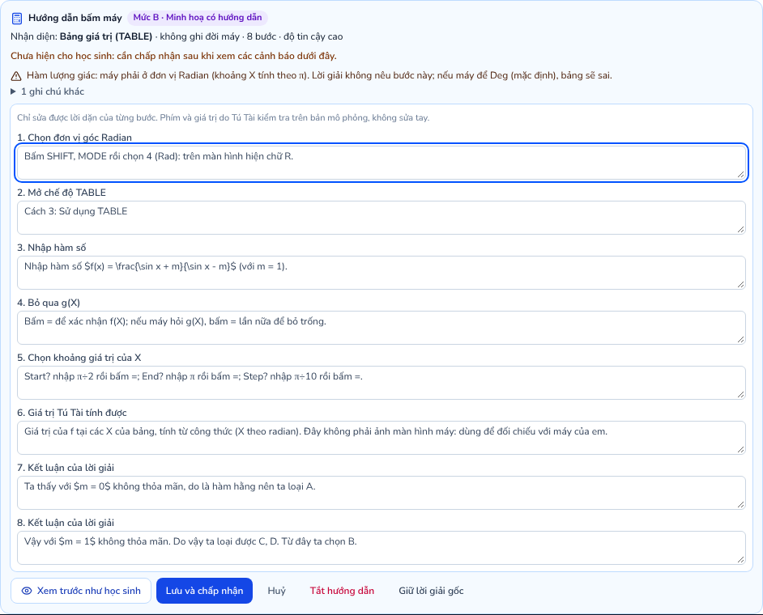 | 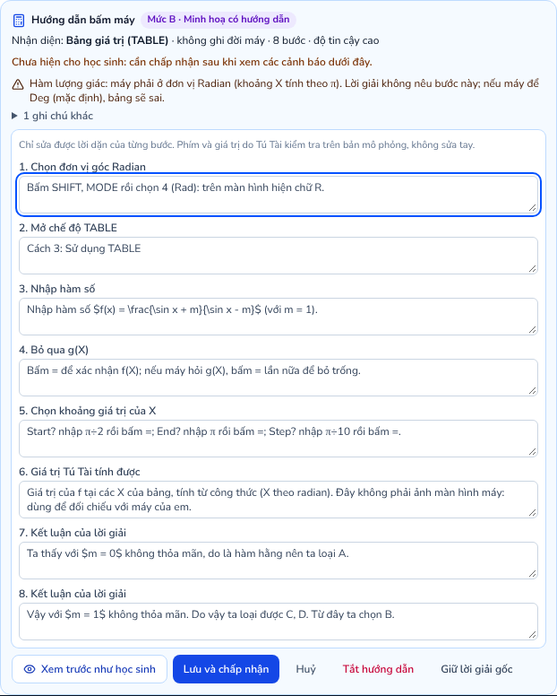 | 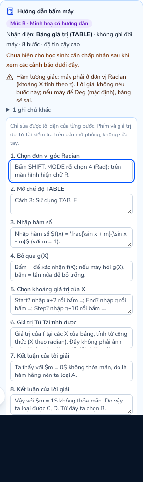 |
| 9 | Câu 2, proposed range (partial source) | 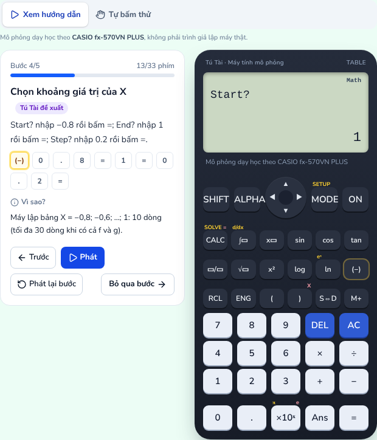 |  | 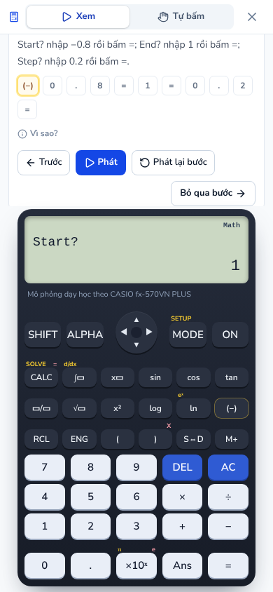 |
| 10 | sin (unsupported), computed values | 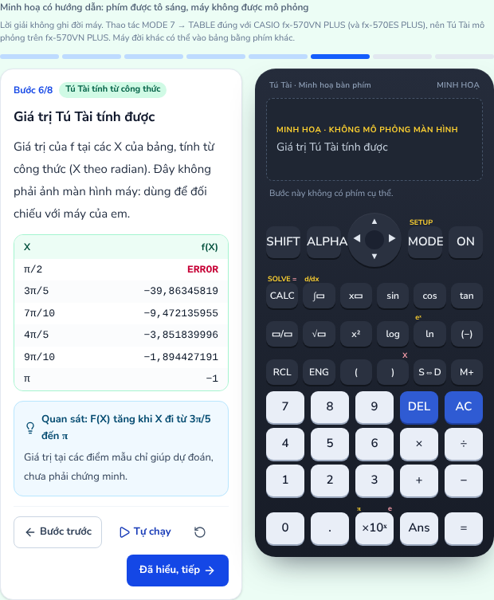 |  | 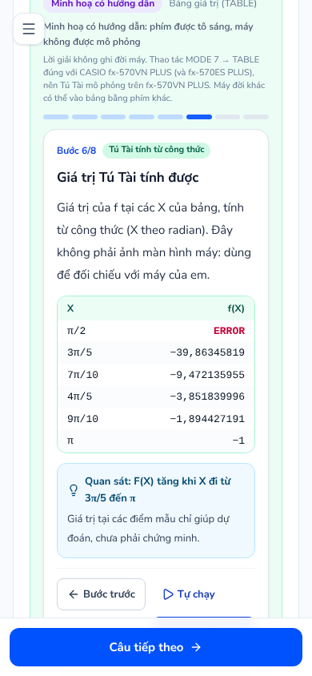 |

The original x / ln x tutorial: phase 1 screenshots below (re-run with the phase 2 code, all checks pass).

## P2.7 Video: a newly supported question, no configuration file

- [`video/generated-q20-1440.mp4`](video/generated-q20-1440.mp4) (77 s, desktop, mouse)
- [`video/generated-q20-390.mp4`](video/generated-q20-390.mp4) (phone, touch)

Câu 20 (Production text, verbatim) → answer → "Thực hành bằng máy tính" → automatic demo of (2X−3)÷√(X²−1) → pause → student presses every remaining key → ERROR rows → readings → conclusion. Recorded by `e2e/video2.mjs`. `git grep` finds no reference to Câu 20 or its id in the guide code (also asserted by a unit test).

## P2.8 Tests

- **Unit (vitest, `lib/calculator-tutor/`): 62 tests pass**, including detection over the real snapshot, the 8 cases of the brief, and safety rules (no other model simulated as fx-570VN PLUS, corrections never change keys, Admin can disable even the reference, no question id in guide code).
- **Full suite:** 795 pass; the 4 failures are the pre-existing `features/roadmap` tests (fail on `master` too).
- `tsc --noEmit`, `eslint`, `next build`: clean.
- **Browser, `e2e/phase2.mjs`: 32 / 32 at 1440 (mouse), 768 (keyboard), 390 (touch)**: student before/after answer, every generated key pressed, no request to the server from the tutor (grading, attempts, streak, XP untouched), level B and C, hidden-until-accepted, Admin accept / correct / original / disable / clear checked in the database, second attempt, no horizontal overflow, no page error.
- **Phase 1 regression, `e2e/after.mjs`: all checks pass at all three sizes** (32 / 32 at 1440, 31 / 31 at 768, 32 / 32 at 390).

| Brief case | Data | Result |
|---|---|---|
| 1 x / ln x | real | A, reference; generator alone also A |
| 2 another TABLE | real (Câu 20) | A, generated, visible |
| 3 SOLVE | synthetic | B, SHIFT SOLVE lit, no screen |
| 4 CALC | synthetic | B; stated result checked against the formula, mismatch held for review |
| 5 partial | real (Câu 2) | A with proposed range, hidden until accepted |
| 6 wrong / ambiguous keys | real (Câu 1 SHIFT ×10ˣ) + synthetic | corrected when certain, otherwise held for review |
| 7 no method | real (Câu 3) | no guide, original solution only |
| 8 unsupported function | real (Dạng 2 Câu 11, sin) | B, values computed and labelled, Radian step flagged |

## P2.9 Preview URL

Vercel builds the branch automatically: https://tutaiproject-git-feature-interactiv-4d8ef0-thiminhdats-projects.vercel.app . It may share the Production database, so on it use only Admin → "Xem trước như học sinh" (nothing is saved) and do **not** click Chấp nhận / Tắt / Giữ lời giải gốc there: those write the decision to the question.

## P2.10 Limitations

1. Real data has only TABLE methods; SOLVE and CALC paths are proven on synthetic questions only.
2. Level B is an illustration: keys are lit, screens are not simulated, and the panel says so.
3. Proposed ranges (Câu 2) and the Radian step (Câu 11) are Tú Tài's additions, labelled, and need Admin acceptance.
4. Real-device check of the fx-570VN PLUS screens is still pending (as in phase 1).
5. Dạng 2 must be imported into the bank before its questions can show a guide.
6. The decision is stored inside the question; editing the question's content resets it on purpose.

---

# Phase 1 (pilot): y = x / ln x (Toán 12)

**Question:** math_book_3, Câu 1 (exercise p. 19, solution p. 29), Production `Q-MAT-TPG9WI` (`q-b48ea52f-2c80-41f8-9740-852bbad40ed5`), lesson *Tính đơn điệu của hàm số (P1)*.
**Branch:** `feature/interactive-calculator-tutor`, from `master` at `fcd81cb` (#37). Draft PR, **not for merge until the owner approves the learning experience.**
**Status:** nothing deployed, nothing written to Production. Production was only *read* once (one `select` of this question, to copy it verbatim into the QA seed). Every browser run used an isolated local Postgres database (`calc_tutor_e2e`, recreated before each run) and a production build (`next build` + `next start`).

**Final status: READY FOR OWNER VISUAL REVIEW**

---

## P1.1 Audit

### Where things live

| What | Where |
|---|---|
| Question + imported solution | `content_documents['question-bank/questions']`; the solution is one string, `question.explanation` |
| Import of textbook solutions | `lib/textbook-reference/practice-import.ts` (answer key → `explanation`, verbatim) |
| Multiple methods | **Not represented.** There is no method field; "Cách 1 / Cách 2" only exist as text inside `explanation` |
| Admin preview | `components/admin/practice/student-preview.tsx` (in-memory grading, opened from the lesson practice page and the textbook workspace) |
| Student solution | `FeedbackPanel` / `SolutionSteps` in `features/lessons/components/practice-session.tsx`, shown only after the server graded an answer |
| Math rendering | `QuestionMath` (`components/shared/question-content-renderer.tsx`, LaTeX subset of `lib/content/math-notation.ts`) |
| Animation | `tw-animate-css` classes behind `motion-safe:` (same as Interactive Math P1) |

### The imported solution as students see it today

17 numbered lines, two methods run together, no calculator screens ([before, 1440](screenshots/before/1440-student-solution-panel.png), [before, 390](screenshots/before/390-student-solution-panel.png)):

| Before (1440) | Before (390, full page) |
|---|---|
| 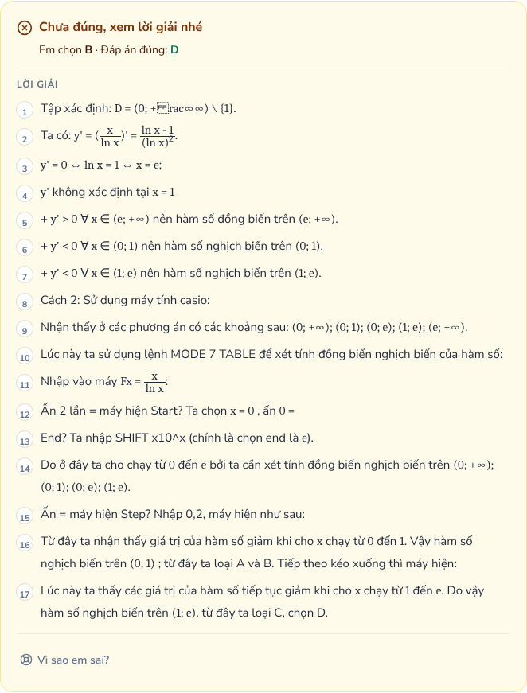 | 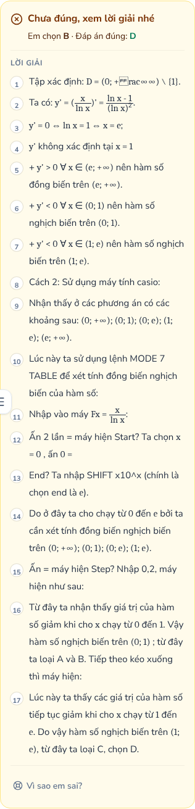 |

### Mathematics (checked)

- Domain $D = (0; +\infty) \setminus \{1\}$; $y' = \frac{\ln x - 1}{(\ln x)^2}$; $y' = 0 \Leftrightarrow x = e$.
- Decreasing on $(0;1)$ and $(1;e)$, increasing on $(e;+\infty)$ → **D**. B is wrong because $1 \notin D$.

### Problems in the source and in the import

| # | Kind | Finding |
|---|---|---|
| 1 | Import error (visible to students) | The domain line contains a form-feed control character: `(0; +\frac{\infty}{\infty})` was stored with `\f` → it renders as "(0; +␌rac∞∞)". The printed book says $(0;+\infty)\setminus\{1\}$. |
| 2 | Invalid instruction | "Start? Ta chọn x = 0": $x = 0$ is outside the domain; the calculator shows ERROR on that row. |
| 3 | Wrong key | "End? SHIFT ×10ˣ (chính là e)". On this calculator family SHIFT ×10ˣ is **π**, ALPHA ×10ˣ is **e**, as the key picture printed in the book itself shows (π on the left/SHIFT side, e on the right/ALPHA side). |
| 4 | Misleading | The book's table runs 0 → e across $x = 1$ and stops before the function increases, so it never shows the increase on $(e;+\infty)$; sampled values are presented as if they proved monotonicity. |
| 5 | Missing | The four calculator screenshots of the book were not imported; "máy hiện như sau:" points to nothing. |
| 6 | Lost structure | The heading "Cách 1: Cách tư duy" was lost in import, so the two methods are one block. |
| 7 | Model-dependent | "MODE 7 TABLE" and "Ấn 2 lần =" are fx-570VN PLUS / ES PLUS behaviour (TABLE is item 7; the reset setting asks for g(X)). The fx-580VN X opens tables differently. |

The source text is **not modified**. It is shown under "Lời giải gốc đã nhập (sách tr. 29, giữ nguyên văn)" with these notes next to it.

---

## P1.2 Calculator integration: feasibility

| | Official CASIO emulator (ClassWiz Emulator / ClassPad.net) | **Focused Tú Tài teaching simulation (chosen)** |
|---|---|---|
| Rights | Licensed per teacher/school ([license codes](https://edu.casio.com/intl/software/emulators/licensecode-fxes)); no public embedding licence or API for third-party web apps found | Our own code and artwork; no CASIO ROM, firmware, logo or key art |
| Technical | Desktop software / ClassPad.net web app; no documented iframe/postMessage API to drive keys, highlight, or read the screen | Fully scriptable: highlight, demo, validate each key, read the screen |
| Model | fx-580VN X / ClassWiz family; does not match the source's MODE 7 (fx-570VN PLUS) | Matches the model the source uses |
| Teaching | A real calculator, but no guidance layer | Built for guidance: demo, practice, hints, checkpoints |
| Risk | Licence + integration unknown; would need CASIO's permission | Must be honest about scope (see below) |

MathLive / Compute Engine were not needed: the only expression grammar is digits, X, e, π, + − × ÷, ln, brackets, so a 120-line parser is lighter and fully tested. No new dependency was added.

**What it is:** a *guided teaching simulation* of the TABLE function of the **CASIO fx-570VN PLUS**, labelled as such in the UI ("Mô phỏng dạy học theo CASIO fx-570VN PLUS, không phải trình giả lập máy thật"). **What it is not:** an emulator. Keys outside the TABLE lesson (√, x², log, fraction, RCL, other modes, SETUP…) answer "nằm ngoài phạm vi bản mô phỏng" and change nothing.

**Key sequence verification** against official CASIO documentation:
- [fx-570VN PLUS user's guide (VI)](https://support.casio.com/storage/vi/manual/pdf/VI/004/fx-570VNPLUS_VI.pdf): mode list in order COMP, CMPLX, STAT, BASE-N, EQN, MATRIX, **TABLE (7)**, VECTOR…; TABLE setup "f(x)" / "f(x),g(x)", **reset default f(x),g(x)** (hence g(X)= is asked).
- [fx-570ES PLUS manual: creating a number table](https://support.casio.com/global/en/calc/manual/fx-570ESPLUS_991ESPLUS_en/using_calculation_modes/creating_number.html): Start/End/Step prompts, defaults 1/5/1, End ≥ Start, row limit, any variable other than X treated as constant.
- [fx-580VN X manual: Table](https://support.casio.com/global/vi/fx/manual/fx-580VNX_VI/using_calculation_modes/creating_number/function.html): 45 rows with f(x), 30 with f(x),g(x); used only to confirm we must not mix models.
- The official pages render keys as images, so the exact key glyphs (ALPHA ")" = X, ALPHA ×10ˣ = e) were confirmed from the key picture printed in the source page and the standard key layout of the model. **To confirm on a physical fx-570VN PLUS before release** (see limitations).
- Table cell formatting: the real screens printed on p. 29 show values **cut**, not rounded, to 6 characters (6.5817 for 6.58178, −1.174 for −1.17457). The simulation does the same; all 7 printed cells are reproduced exactly (unit test).

---

## P1.3 What was built

### Experience

After answering, the solution of this question becomes two tabs:

- **Cách 1: Giải bằng đạo hàm**: 6 short steps (domain with the reason, derivative, $y'=0$, sign on each interval, conclusion highlighted, why B is wrong) and a sign table.
- **Cách 2: Thực hành máy tính**: the calculator tutor.
- Below both: the imported source, collapsed, verbatim, with the 6 applicable notes.

The tutor teaches 8 steps / 66 key presses:

1. MODE 7 (TABLE) · 2. X ÷ ln(X) · 3. = = (skip g(X)) · 4. **Start 0, End 2, Step 0.5**: shows that x = 0 and x = 1 are ERROR rows, with a checkpoint "ERROR không phải là một giá trị" · 5. AC = = and **(0;1)**: Start 0.1, End 0.9, Step 0.1 · 6. read it (decreasing) · 7. **(1;4)**: Start 1.2, End 4, Step 0.2 (15 rows) · 8. read it: decreasing to 2.7194 at x = 2.8, then increasing; minimum near $e$ where $f(e)=e$. Conclusion: what the table rules out (A, C), and that it is **not a proof**; the derivative is.

- **Xem hướng dẫn**: highlights the next key (pulsing ring + a small pointer beside it, never on the label), presses it after ~1 s, updates the LCD and says what happened; pauses at checkpoints; Trước / Bỏ qua bước / Phát lại bước / Tạm dừng–Tiếp tục.
- **Tự bấm thử**: the student presses keys (mouse, touch, or keyboard: digits, Enter `=`, Esc `AC`, arrows, M `MODE`, A `ALPHA`, L `ln`). A correct key is applied by the real simulation; a wrong key is **not applied** and gets a gentle explanation ("Phím 5 không dùng ở bước này"); the second miss lights up the right key; Gợi ý shows a hint; Làm lại restarts. Completion shows a short success state, then **Thử tự do** (any range, computed for real) or Luyện lại.
- **Phone (≤ 639 px)**: the tutor opens as a full-screen workspace: mode switch in the top bar, the current instruction and controls on top, the whole keypad below, both on screen at 390 × 844; × returns to the solution.
- `prefers-reduced-motion`: no pulsing, pointer bounce or fades; the demo still advances key by key.

### Architecture

| File | Role |
|---|---|
| `lib/calculator-tutor/fx570vn-plus.ts` | The simulation: key faces, state machine (COMP → MODE menu → f(X) → g(X) → Start/End/Step → table / ERROR), expression parser/evaluator, ERROR for undefined values, Range ERROR (> 30 rows, End < Start), Syntax ERROR, 6-character cells. Pure, no React. |
| `lib/calculator-tutor/types.ts` | `CalculatorTutorial` (model, function, domain, steps with keys, explanations, hints, checkpoints, expected screens, references) and `SolutionGuide` (methods, source notes, verification). |
| `lib/calculator-tutor/guides/x-over-ln-x.ts` | The one verified guide. Hand-written configuration, never generated from extracted text. |
| `lib/calculator-tutor/registry.ts` | Matches a question to a guide (by id, or same book + question number + same formula) and attaches it to graded feedback. |
| `components/learning/calculator-tutor/*` | `CalculatorDevice`, `CalculatorTutor`, `SolutionGuideView`. |
| `lib/practice/practice-service.ts`, `lib/practice/grading.ts` | The guide is attached **on the server**, to the feedback of an answered question only (same moment the explanation is revealed). |
| `features/lessons/components/practice-session.tsx`, `components/admin/practice/student-preview.tsx` | Render the guide when present; otherwise unchanged. Admin sees a verification panel: who/when, checks, and the full key sequence replayed live with ✓ per step. |

No schema change, no migration, no new dependency, no change to grading, publication rules, attempts, streaks or XP. Admin does not author animations: a guide is data, and the animation comes from the sequence.

---

## P1.4 Screenshots (real Chromium, production build)

| # | State | 1440 × 900 (mouse) | 768 × 1024 (keyboard) | 390 × 844 (touch) |
|---|---|---|---|---|
| 1 | Original long solution |  | n/a |  |
| 2 | Method selection (Cách 1 open) | 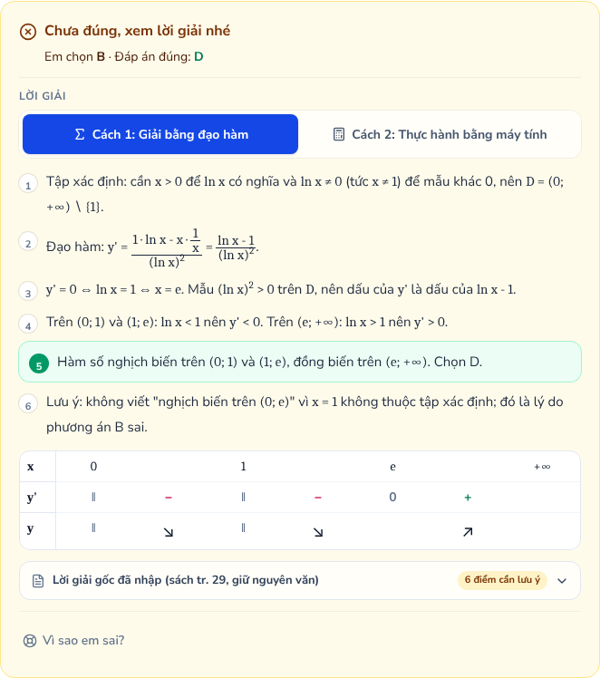 | 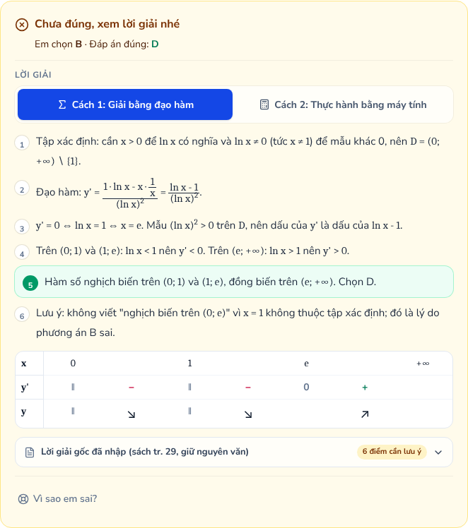 | 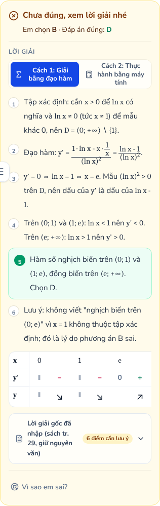 |
| 3 | Tutorial start | 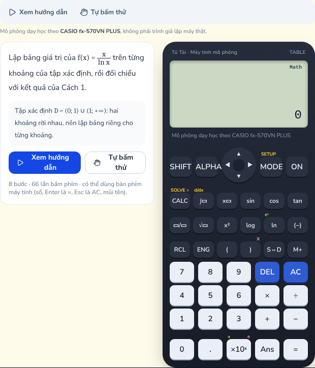 | 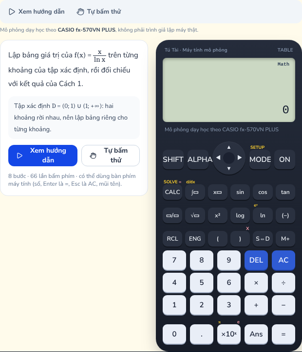 | 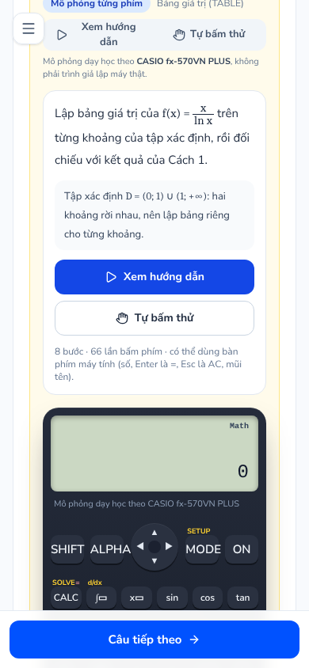 |
| 4 | Highlighted key in the demo |  | 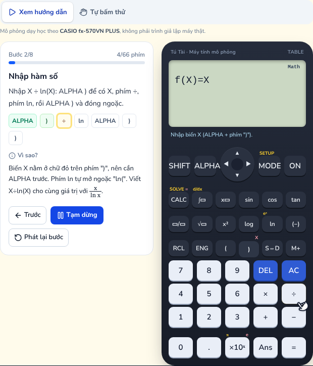 | 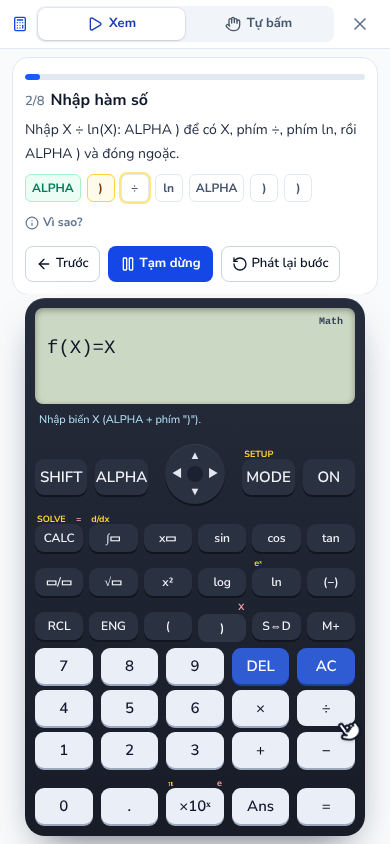 |
| 5 | Function entered | 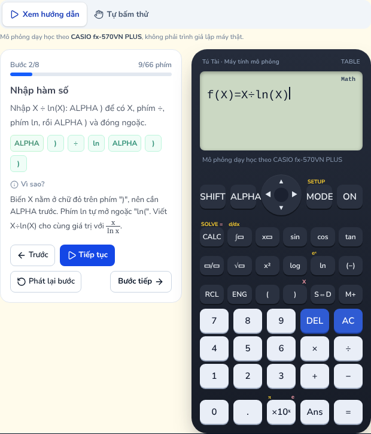 | 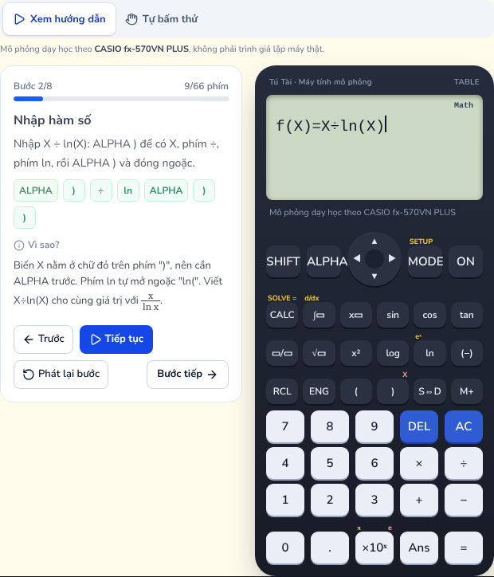 | 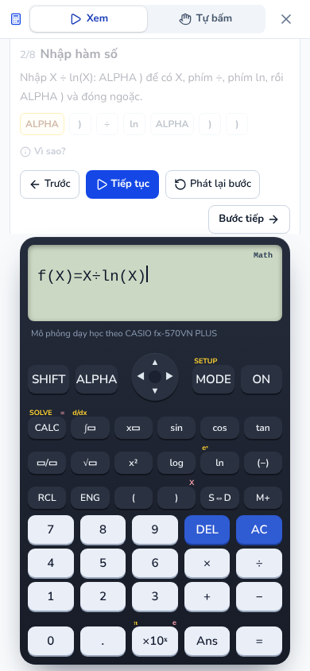 |
| 6 | TABLE range configuration | 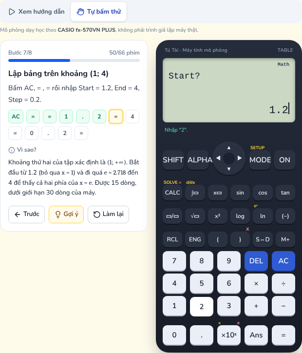 | 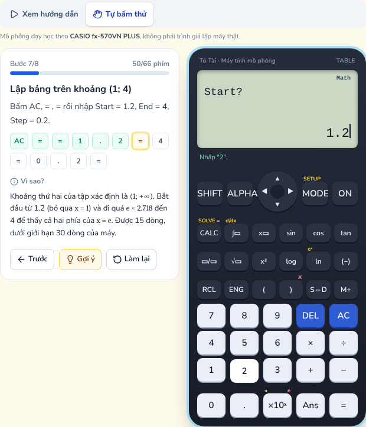 | 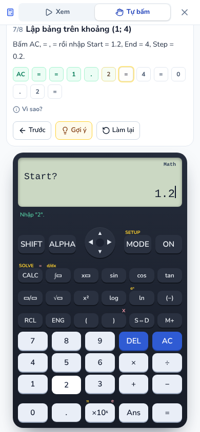 |
| 7a | ERROR rows at x = 0, x = 1 |  | 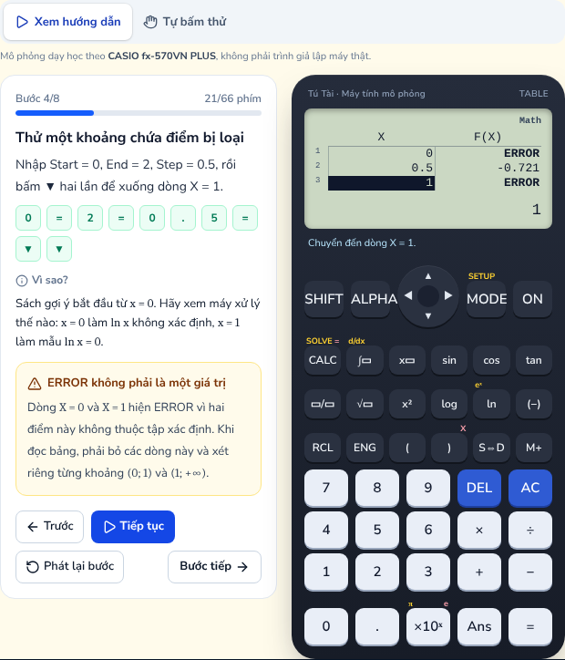 | 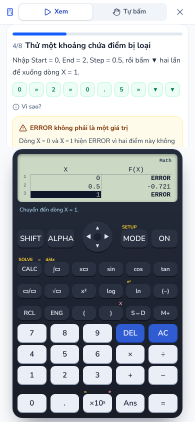 |
| 7b | TABLE results on (1; 4) | 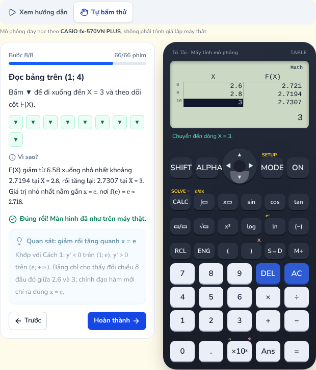 | 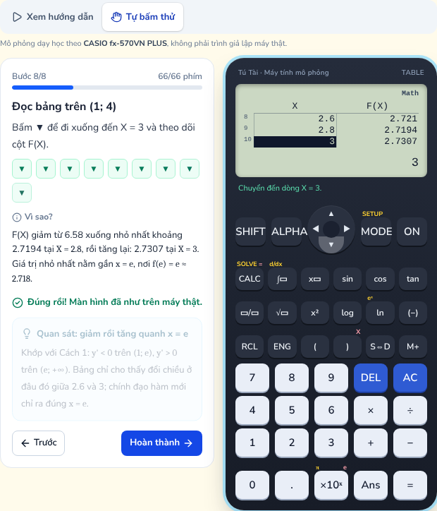 | 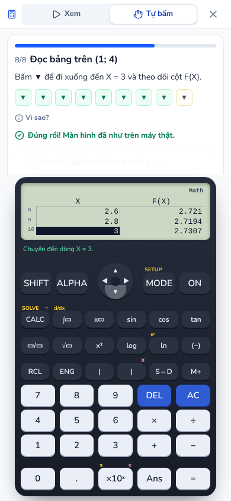 |
| 8 | Wrong-key feedback | 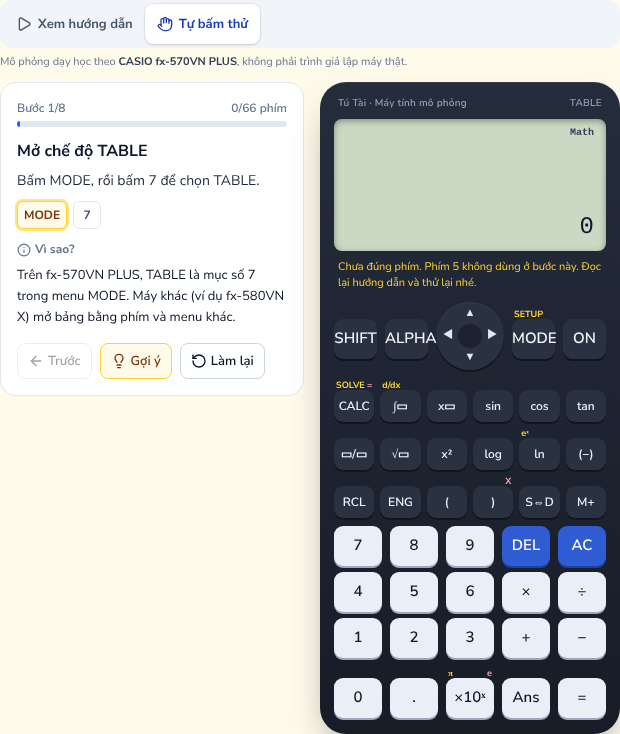 | 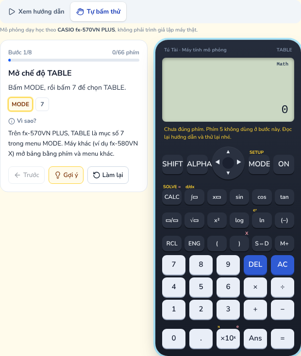 | 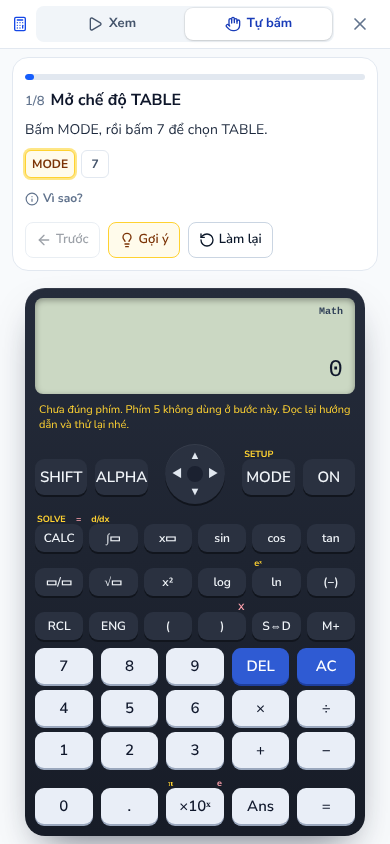 |
| 9 | Completion | 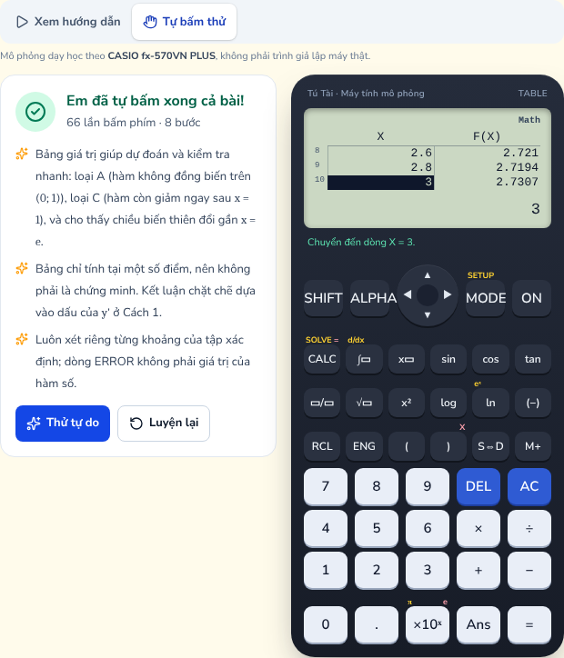 |  | 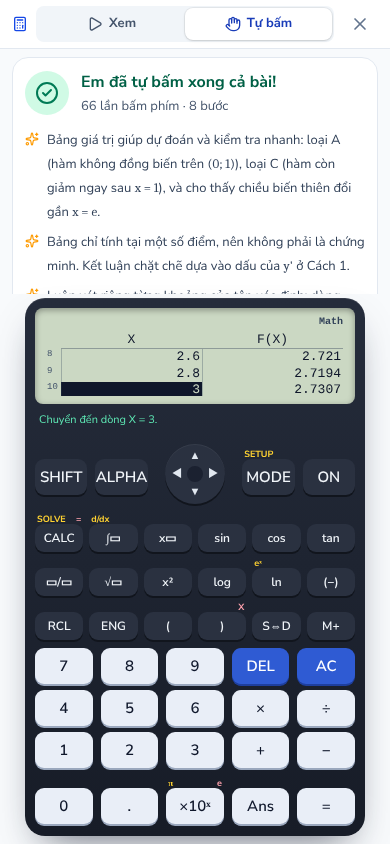 |
| 10 | Source kept + notes |  | 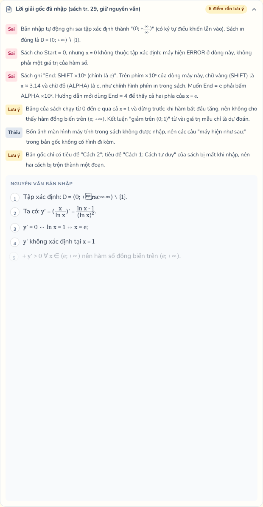 |  |
| 11 | Admin verification |  |  |  |

## P1.5 Video (real browser recordings, not mock-ups)

- [`video/student-1440.mp4`](video/student-1440.mp4) (94 s, desktop, mouse)
- [`video/student-390.mp4`](video/student-390.mp4) (94 s, phone, touch)

Both: answer → solution → Cách 1 → open Cách 2 → automatic demonstration (MODE, 7, X ÷ ln(X), = =) → pause → switch to Tự bấm thử → wrong key (5) and its correction → second wrong key lights up MODE → Gợi ý → all 66 presses with the checkpoints → completion. Recorded with Playwright `recordVideo` by `e2e/video.mjs`.

---

## P1.6 Mathematical verification (`lib/calculator-tutor/*.test.ts`, 32 tests)

- Each of the 8 steps is replayed key by key on the simulation and must leave exactly its declared screen (same check is shown live to Admin).
- Every table row of the guide: undefined exactly when $x \le 0$ or $x = 1$ (shown ERROR), otherwise equal to $x/\ln x$ computed independently (1e-9).
- (0;1) sampled values strictly decreasing; (1;4) minimum at x = 2.8, |2.8 − e| < 0.2, ≤ 30 rows.
- Sign of $y'$ at 0.5, 2, 4 = −, −, + (matches the sign table); Method 1 concludes D.
- Printed cells of p. 29 reproduced: −0.124, −0.436, −1.174, −3.585, 6.5817, 4.1608, 2.7902 (and 3.0623, 2.8853).
- Parser: precedence, implied multiplication, ERROR for ln of non-positive / division by zero, Syntax ERROR, SHIFT ×10ˣ = π vs ALPHA ×10ˣ = e, Range ERROR beyond 30 rows or End < Start, default 1/5/1, g(X) prompt.
- Unsupported keys and modes are refused without changing state.
- Matching: the guide attaches to this question only (not Câu 2, not another book's Câu 1); notes about the import error only appear when the imported text has it; the matching rule is not sent to clients.

## P1.7 Browser and regression tests (`e2e/after.mjs`)

**1440 × 900 mouse: 32/32 · 768 × 1024 keyboard only: 31/31 · 390 × 844 touch: 32/32** ([results-1440.json](e2e/results-1440.json), [results-768.json](e2e/results-768.json), [results-390.json](e2e/results-390.json); logs `e2e/run-*.log`).

| ID | Check |
|---|---|
| P1 | Before answering: no solution, guide or calculator on the page |
| P2 | (1440) none of the 15 scripts loaded by the student page contains the guide (it states the answer) |
| M1–M3 | Two separate methods; Method 1 content and sign table; original solution verbatim (17 lines) with 6 notes |
| L1–L2 | Inline two-column layout at 1440/768; full-screen workspace at 390, closable |
| W0–W5 | Start screen; demo highlights MODE then presses in order; pause holds for 2.6 s and resumes at the same key; Previous; Skip; Replay; pause at checkpoint with ERROR rows |
| T1–T5 | Wrong key not applied, gentle message; second miss highlights the right key; hint; correct keys advance; Làm lại |
| T6–T8 | (0;1) values; Start? 1.2 configuration; (1;4) results; full completion with the viewport's input method |
| T9 | **No API request** while watching/practising; `lesson_completions` / `learning_days` unchanged (no streak/XP) |
| T10–T11 | Free mode computes a new range (ERROR at x = 1); unsupported key says so |
| R1–R2 | A question without a guide keeps the old solution; Interactive Math P1 still renders |
| A1–A3 | Admin preview shows the verified guide, 8/8 steps replay to their screen; Admin can try it; a student gets 403 on the question API |
| O, E | No horizontal overflow; no page errors |

Other checks:

| Check | Result |
|---|---|
| `tsc --noEmit` | pass |
| `eslint` on changed files | pass |
| `prettier` on changed files | applied |
| `vitest run` | 765 passed, 4 failed: the same 4 `features/roadmap/...` tests fail identically on `master` (re-run on a clean `master` worktree), unrelated |
| `next build` | pass |

### Reproducing

```
bash docs/reviews/calculator-tutor/e2e/reset.sh            # isolated DB calc_tutor_e2e + seed
pnpm build && bash docs/reviews/calculator-tutor/e2e/start.sh $PWD 3303
BASE=http://localhost:3303 VP=1440 node docs/reviews/calculator-tutor/e2e/after.mjs   # 768, 390
BASE=http://localhost:3303 VP=1440 node docs/reviews/calculator-tutor/e2e/video.mjs
```

`e2e/question-q1-production.json` is the Production question copied verbatim (including the broken domain line). The seed changes only its publication fields (PUBLISHED, OPEN_PRACTICE, rights LICENSED) so a QA student can reach it, and adds two simple QA questions so the lesson has a practice set.

---

## P1.8 Preview URL

None. Vercel Preview may share the Production database, so nothing was deployed; review from the screenshots and videos, or run the steps above.

## P1.9 Known limitations

1. **Physical-device check pending.** Sequence and behaviour follow the official manuals; key glyph positions (ALPHA ")" = X, ALPHA ×10ˣ = e) and the exact ERROR rendering should be confirmed once on a real fx-570VN PLUS.
2. One model only. A student with an fx-580VN X needs a different sequence (Table is opened from the menu, not MODE 7); the type supports another model, but no second guide exists yet.
3. *(Superseded in phase 2: guides are now generated and reviewed in Admin.)* Pilot scope: one guide, linked by configuration. There is no Admin editor for guides; adding one is a code change reviewed in a PR (deliberate: AI-extracted text is never turned into commands).
4. In Production this question is still `IN_REVIEW` with rights "Cần xem xét", so students will see the tutor only once it is published through the existing flow. The broken domain line in its imported explanation is shown with a note but **not corrected**; fixing the stored text is an editorial decision (one-line edit in the question editor).
5. The simulation keeps 10 significant digits and cuts cells to 6 characters like the printed screens; the last digit of very small or very large values may differ from a real screen.
6. In the demo, the screen is updated from the simulation; the "pointer" is a decorative icon beside the key, not a recorded hand.
