# Tú Tài · Làm lại màn Hoàn thành bài học (phần 6/6)

> Trạng thái: **READY FOR OWNER VISUAL REVIEW**. Chưa merge, không deploy Production, không đụng dữ liệu Production. Kết quả test tự động không thay cho duyệt của chủ dự án.

**Về PR #45:** brief ghi "PR #45 chưa được duyệt merge", nhưng khi kiểm tra thật thì PR #45 **đã được merge** vào `master` lúc 08:22 UTC ngày 24/11/2026 (merge commit `b0e250f`). Không thể đẩy tiếp vào một PR đã merge, nên vòng này nằm ở **một PR nháp mới**, nhánh `feature/lesson-completion-redesign` tạo từ `master` mới nhất. PR mới chưa merge và chờ chủ dự án duyệt ảnh.

Ảnh chụp của chủ dự án không có trong tin nhắn. Em đã tái hiện đúng trạng thái trong ảnh trên bản `master` hiện tại: học sinh học xong bài, mở trang luyện tập rồi quay lại khi chưa làm câu nào. Màn hình khi đó ghi "Em đang luyện tập dở · Đã làm 0/6 câu" (ảnh 01). Production có 10 câu nên ảnh của chủ dự án ghi 0/10.

Mọi thay đổi nằm trong component dùng chung của bài học tương tác. Không có gì viết riêng cho bài P1: "Điều cần nhớ", mục tiêu, danh sách phần ôn lại đều lấy từ nội dung bài.

## A. Kết quả rà soát

Trạng thái trước (bản `master` b0e250f), đo bằng Playwright:

| Vấn đề | Bằng chứng |
| --- | --- |
| **Báo "đã xong" 5 lần:** "Phần 6/6", 6 ô tiến độ xanh, chữ "Đã học xong" ở header, thẻ "Em đã học xong bài này", dấu check xanh. Header còn lặp "Ý chính" trùng với ý 1 của "Điều cần nhớ". | ảnh 01, cặp trước/sau đầu tiên |
| **Header rời rạc:** bên trái là nút "Học Toán 12", chương, tiêu đề, "Ý chính"; bên phải là thanh 6 phần, "Đã học xong" và loa. Hai nửa không liên quan, chiếm cả chiều ngang. | |
| **Nội dung lệch trục:** khối nội dung giới hạn 1.040 px và căn giữa, còn header căn trái 1.180 px, nên các thẻ thụt vào so với tiêu đề. | |
| **Ba thẻ rời và các nút lạc chỗ:** thẻ trạng thái, thẻ "Điều cần nhớ" (dạng mở/đóng), thẻ luyện tập ở cột phải. "Mục tiêu bài học" là một dòng mờ, hai nút "Xem lại từ đầu" và "Thử thách lại" lơ lửng ở dưới. Cột phải trống từ khoảng 430 px trở xuống. | |
| **Điều hướng rải ở 5 nơi:** "Học Toán 12", thanh 6 phần, "Xem lại từ đầu", "Thử thách lại", thẻ luyện tập. Ôn một phần cụ thể chỉ làm được qua thanh tiến độ mảnh, không có nhãn rõ trên điện thoại. | |
| **Lời luyện tập sai sự thật:** khi phiên luyện tập vừa mở mà chưa trả lời câu nào (`answeredCount = 0`), thẻ vẫn ghi "Em đang luyện tập dở · Đã làm 0/6 câu" kèm thanh tiến độ rỗng. Mã cũ coi mọi phiên `IN_PROGRESS` là đang làm dở. | `lesson-practice-card.tsx` cũ, ảnh 01 |
| **Nhãn chưa rõ:** "Xem lại từ đầu" thật ra mở phần 1 ở chế độ xem lại, không xoá gì. "Thử thách lại" mở lại phần Tự làm trống, kết quả tốt nhất vẫn giữ. Cả hai đều không nói điều đó. | `lesson-progress.ts` giữ kết quả tốt nhất |
| **Mục tiêu bài học:** đặt dưới cùng như thông tin phụ, viết như việc sắp làm, trong khi học sinh đã học xong. | |

## B. Quyết định thiết kế

**Màn này trả lời ba câu, theo đúng thứ tự:** em xong chưa, cần nhớ gì, học gì tiếp.

1. **Một tấm duy nhất thay cho ba thẻ.** Tấm chia hai vùng bằng nền và đường kẻ mảnh, không dùng thẻ lồng thẻ.
   - Bên trái (vùng chính): kết quả, rồi "Điều cần nhớ".
   - Bên phải (nền xám xanh nhạt): bước tiếp theo, rồi "Ôn lại bài".
   - Tấm thẳng hàng với tiêu đề bài.
2. **Header ở phần cuối chỉ giữ cái còn cần:**
   - Giữ "Học Toán 12" (lối ra chung của mọi phần), chương và tiêu đề.
   - Bỏ thanh 6 phần, "Đã học xong", "Ý chính" và loa: tấm bên dưới đã nói bài xong, đã liệt kê các phần để ôn, đã có Điều cần nhớ.
   - Khi học sinh mở lại một phần để ôn, thanh tiến độ và loa hiện lại như cũ.
3. **Nói "xong" một lần:**
   - Lần đầu: dòng nhỏ "✓ Hoàn thành bài học", rồi tiêu đề "Tuyệt vời! Em đã tự khám phá cả bài." và ô chuỗi ngày học có hiệu ứng.
   - Mở lại: chỉ "✓ Em đã học xong bài này", kèm số câu đúng và chuỗi ngày trên một dòng.
4. **Điều cần nhớ là phần chữ chính:**
   - Chữ 16 px, đánh số, mỗi ý cách nhau một đường kẻ, công thức hiển thị bằng KaTeX như trong bài.
   - Không mở/đóng, không mỗi ý một thẻ.
   - Bài có 9 ý vẫn đọc tự nhiên; trang cuộn bình thường, không có vùng cuộn lồng.
5. **Mục tiêu thành kết quả đạt được:** "Mục tiêu em đã đạt (3)", mở ra là danh sách có dấu ✓, kèm tài liệu tham khảo nếu bài có. Nội dung không bị bỏ.
6. **Một hành động chính, chọn theo trạng thái thật** (quy tắc chọn bài tiếp theo của lộ trình giữ nguyên):

| Trạng thái | Tiêu đề | Nút chính | Liên kết phụ |
| --- | --- | --- | --- |
| Chưa luyện tập | Luyện tập để hoàn thành bài | Bắt đầu luyện tập | Học bài tiếp: … |
| Đã mở phiên, 0 câu | Bài luyện tập đang chờ em ("6 câu, chưa trả lời câu nào") | Bắt đầu làm bài (mở **đúng phiên cũ**, không tạo phiên mới) | Học bài tiếp: … |
| Đang làm dở | Em đang luyện tập dở · Đã làm 2/6 câu + thanh tiến độ | Làm tiếp luyện tập | Học bài tiếp: … |
| Đã đạt | Sẵn sàng cho bài tiếp theo · "Luyện tập bài này đạt 6/6 câu đúng" | Bắt đầu học: bài kế | Luyện tập lại |
| Chưa đạt | Luyện thêm để hoàn thành bài · tốt nhất x/y | Luyện tập lại | Xem lại bài đã làm |
| Bài không có câu luyện tập | Sẵn sàng cho bài tiếp theo | Bắt đầu học: bài kế | |
| Không tải được | Chưa tải được phần luyện tập | Bài kế hoặc Về lộ trình | |

7. **"Ôn lại bài" là nhóm phụ, gom một chỗ:**
   - Mỗi phần một dòng: "1 Quan sát · Đồ thị này đi đâu?" (desktop), hoặc một viên "1 Quan sát" (điện thoại).
   - Câu giải thích: "Mở lại một phần để xem câu trả lời của em. Bài vẫn được tính là đã học."
   - "Làm lại phần Tự làm, giữ kết quả tốt nhất" thay cho "Thử thách lại".
   - "Xem lại từ đầu" chính là dòng phần 1.
8. **Thứ tự trên điện thoại:** xong rồi, bước tiếp theo, ôn lại (gọn dạng viên), rồi Điều cần nhớ. Nút chính nằm trong màn hình đầu.
9. **Ăn mừng giữ nguyên:** chỉ lần hoàn thành đầu tiên mới có pháo hoa và chuông, mỗi thứ một lần. Tải lại, mở lại, ôn từng phần đều không phát lại. Không có nút phát lại hiệu ứng, không có nút âm thanh trên màn tổng kết.

## C. Trước / sau

Cùng bài, cùng khung nhìn, cùng trạng thái học sinh.

**Phiên luyện tập vừa mở, 0 câu (trạng thái trong ảnh của chủ dự án)** (1440 px, trái: trước, phải: sau)

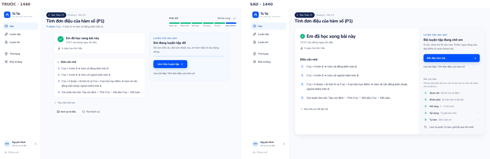

**Mở lại bài đã học, chưa luyện tập** (1366 px, trái: trước, phải: sau)

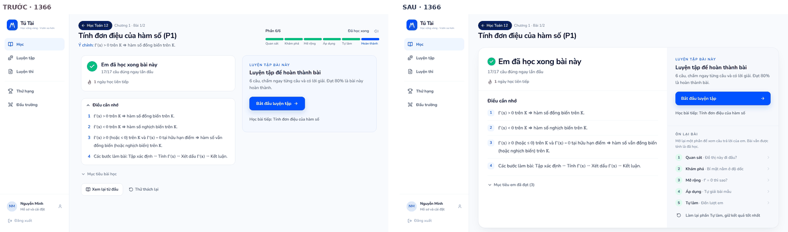

**Vừa hoàn thành lần đầu** (1920 px, trái: trước, phải: sau)

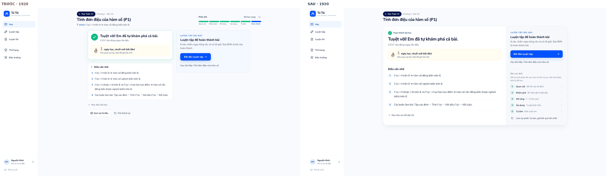

**Điều cần nhớ dài (toàn trang)** (1440 px, trái: trước, phải: sau)

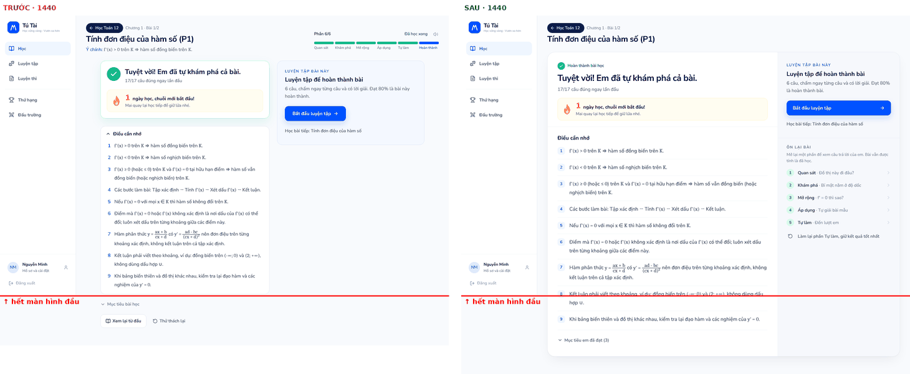

**Điện thoại, mở lại bài (toàn trang)** (390 px, trái: trước, phải: sau)

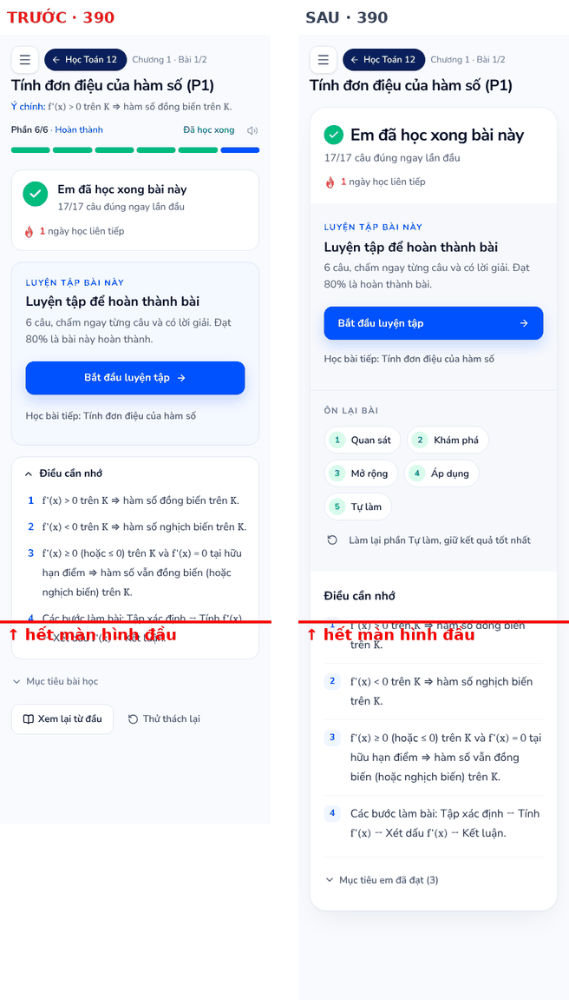

**Bài không có câu luyện tập** (1440 px, trái: trước, phải: sau)

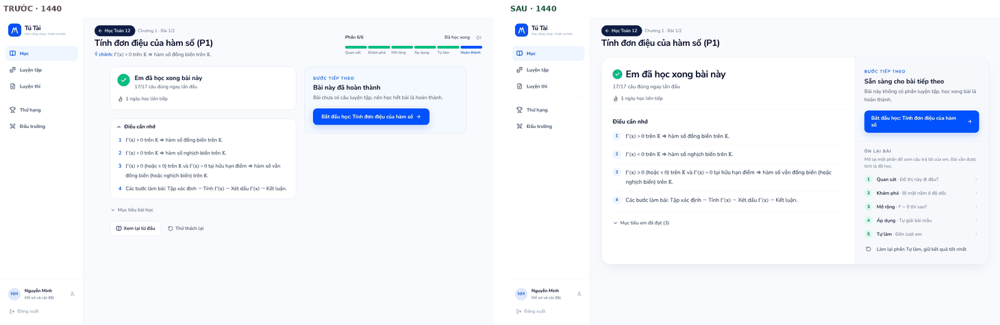

## D. Ảnh chụp cuối (trình duyệt thật, theo khung nhìn)

Ảnh desktop được thu nhỏ còn 60% để nhẹ repo. Ảnh điện thoại giữ kích thước thật. Ảnh có ghi "toàn trang" là ảnh cả trang; các ảnh còn lại là đúng một màn hình.

**01. Trước: màn Hoàn thành hiện tại (phiên luyện tập vừa mở, 0 câu)** (1440×900)

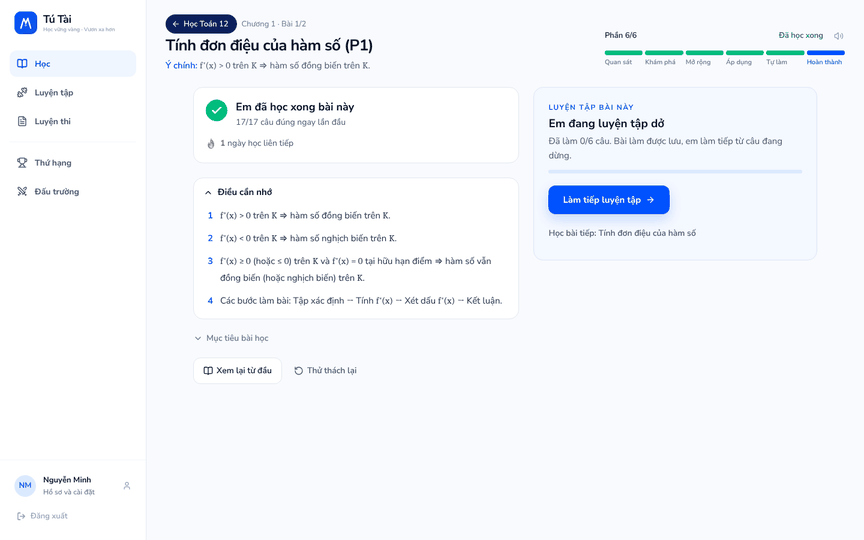

**02. Sau: vừa hoàn thành lần đầu (sau hiệu ứng)** (1440×900)

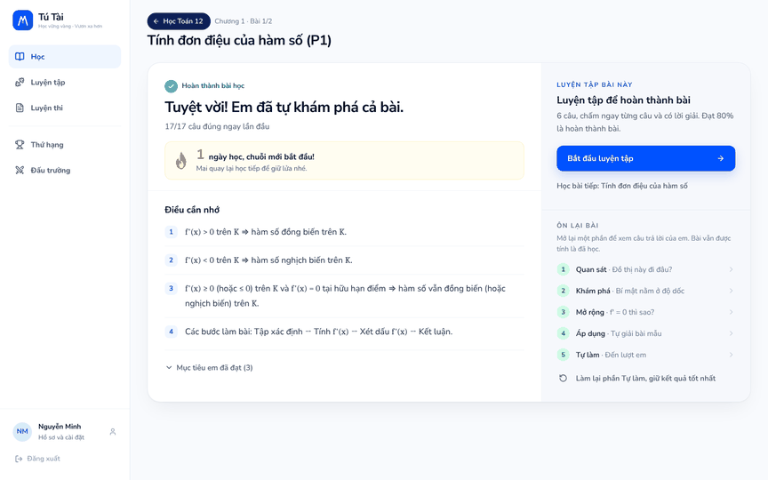

**03. Chưa bắt đầu luyện tập** (1366×768)

**04. Đang luyện tập (2/6 câu)** (1440×900)

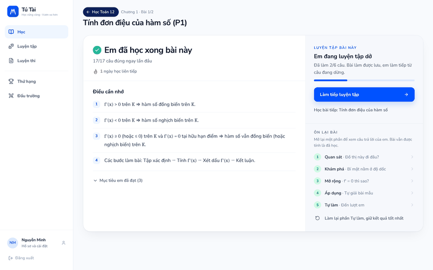

**05. Luyện tập đạt, bước tiếp theo là bài kế** (1440×900)

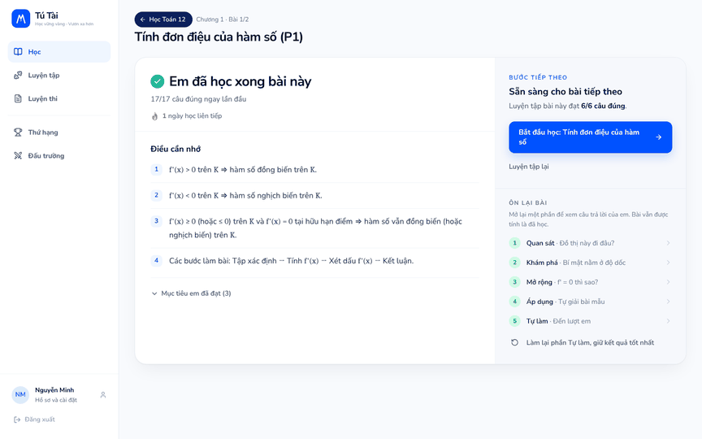

**06. Mở lại bài đã học** (1920×1080)

**07. Có bài tiếp theo (nút chính mở bài kế)** (1366×768)

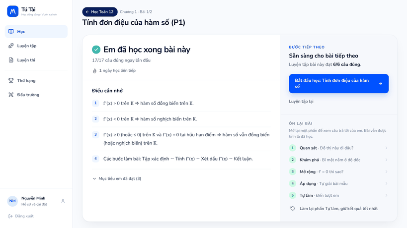

**08. Điều cần nhớ dài (9 ý)** (1440×900)

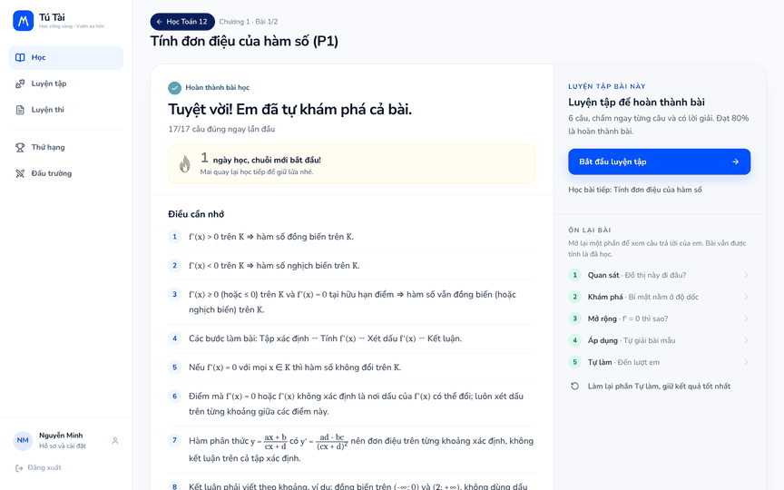

**09. Điện thoại: vừa hoàn thành** (390×844)

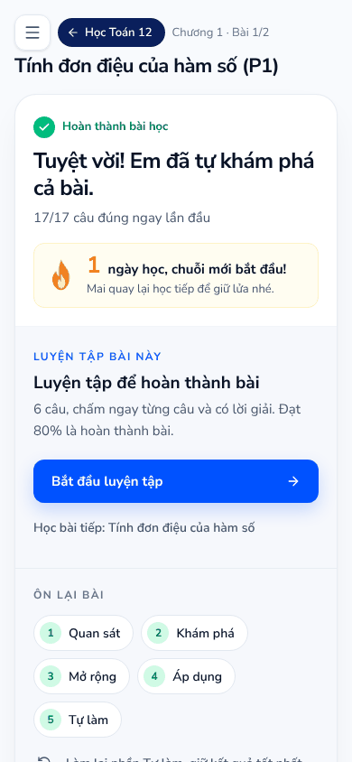

**10. Điện thoại: luyện tập và ôn lại (toàn trang)** (390×844, toàn trang)

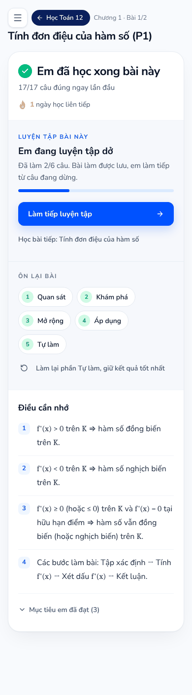

**11. Điện thoại 360: Điều cần nhớ dài (toàn trang)** (360×640, toàn trang)

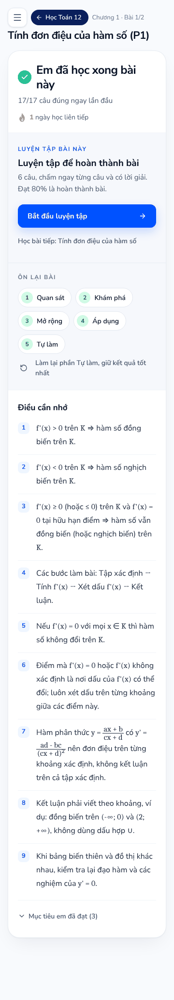

**12. Điện thoại: mở lại bài đã học** (390×844)

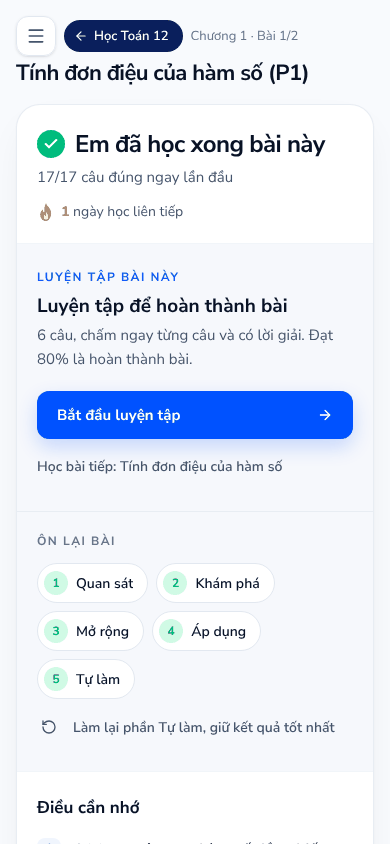

**x1. Phiên luyện tập đã mở, chưa làm câu nào** (1366×768)

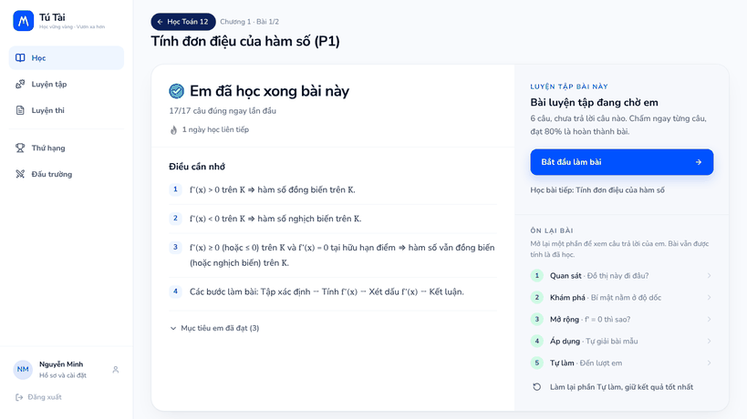

**x2. Bài không có câu luyện tập** (1440×900)

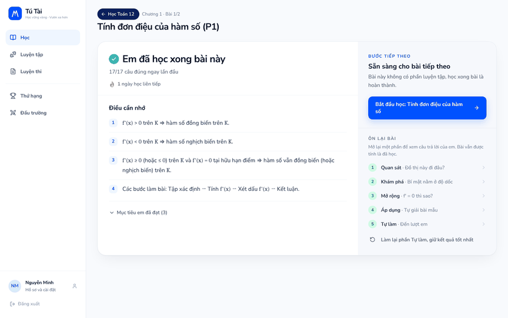

**x3. Điện thoại 360: phiên đã mở, 0 câu** (360×640)

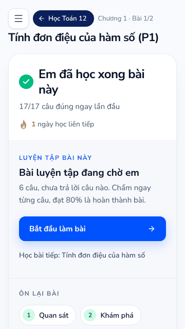

**x4. 1920: Điều cần nhớ dài** (1920×1080)

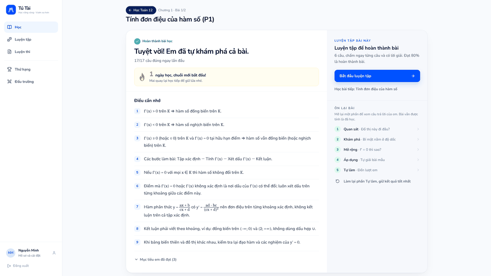

## E. Kiểm thử chức năng (Admin → Học sinh, trình duyệt thật)

Dùng CSDL QA cục bộ `pp_lesson`, không phải Production. Admin xuất bản bài qua Admin UI, học sinh mới học từ lộ trình. Ba bản CSDL thử:
- bản chuẩn;
- bản "Điều cần nhớ" dài 9 ý;
- bản bài không có câu luyện tập.

Cả ba chỉ sửa trên máy QA.

| Khung nhìn | Kết quả |
| --- | --- |
| 1366 | 114/114 PASS |
| 1440 | 114/114 PASS |
| 1920 | 114/114 PASS |
| 390 | 118/118 PASS |
| 360 | 115/115 PASS |

| Hạng mục | Kết quả |
| --- | --- |
| Hoàn thành lần đầu: pháo hoa 1 lần, chuông 1 lần, chuỗi ngày ≤ 1 | PASS |
| Tải lại, mở lại từ lộ trình, ôn từng phần: không phát lại hiệu ứng hay âm thanh | PASS |
| Màn tổng kết không lặp thanh tiến độ và "Đã học xong"; chỉ một nút chính | PASS |
| Chưa luyện tập: "Bắt đầu luyện tập", có liên kết bài tiếp | PASS |
| Phiên đã mở, 0 câu: không ghi "dở", không ghi "0/", nút mở đúng phiên cũ | PASS |
| Đang làm dở: "Đã làm 1/6", "Làm tiếp luyện tập" về đúng phiên | PASS |
| Đã đạt: nút chính là bài tiếp, bấm vào mở bài tiếp | PASS |
| Bài không có câu luyện tập: "Sẵn sàng cho bài tiếp theo" (chụp ảnh ở 5 khung nhìn) | PASS (kiểm tra bằng ảnh, không có assert tự động) |
| Không tải được luyện tập | Unit test (`practice-state.test.ts`); trên trình duyệt NOT TESTED (phải làm hỏng CSDL) |
| Chưa đạt (retry) | Unit test; trên trình duyệt NOT TESTED |
| Ôn từng phần từ danh sách: mở đúng phần, có câu trả lời, nút Tiếp tục mở | PASS |
| "Làm lại phần Tự làm": mở phần 5 trống, quay về tổng kết, tiến độ P1 không đổi | PASS |
| Về lộ trình: lộ trình đánh dấu bài đã học | PASS |
| Tiến độ P1 và tiến độ luyện tập giữ nguyên; server ghi đúng 1 ngày học | PASS |
| Hồi quy phần 1 đến 5: thanh bước, cửa sổ câu hỏi, tải lại giữa chừng, "Phần trước" | PASS |
| Âm thanh tắt, giảm chuyển động | PASS ở 390 và 1440 |
| Không lỗi console, không tràn ngang | PASS |
| Trình đọc màn hình thật, Safari, Firefox, iPhone thật | NOT TESTED (chỉ Chromium) |

## F. Kiểm tra kỹ thuật

| Hạng mục | Kết quả |
| --- | --- |
| `tsc --noEmit` | sạch |
| ESLint trên các tệp đã sửa | sạch |
| ESLint toàn repo | 3 lỗi, **có sẵn trên master**, ở các tệp không đụng tới: `app/layout.tsx`, `qb-page.tsx`, `student-home-overview.tsx` |
| `next build` | thành công |
| Vitest | 841 đạt (thêm 7 test `practiceState`), 58 bỏ qua, 5 lỗi **có sẵn trên master** (4 ở `features/roadmap/lib`, 1 phụ thuộc ngày) |
| Lỗi console khi chụp ảnh ở 5 khung nhìn × 3 bản dữ liệu | 0 |

**Chiều cao trang:**
- Desktop 1440 và 1920: vừa một màn hình ở mọi trạng thái, trừ bản 9 ý (1.152 px ở 1440).
- 1366×768: trang cao 803–828 px. Kết quả, Điều cần nhớ, nút chính và cả danh sách ôn lại đều nằm trong màn hình; chỉ mép dưới của tấm bị khuất.
- Điện thoại: trang dài hơn trước khoảng 250–290 px, vì danh sách ôn lại nay nằm ngay trong trang (trước chỉ có thanh tiến độ mảnh) và Điều cần nhớ dùng chữ 16 px. Nút chính vẫn nằm trong màn hình đầu.

**Giới hạn:**
- Màn tổng kết không còn nút loa; muốn bật/tắt âm thanh thì vào một phần bất kỳ.
- Kiểm thử tự động ở 1440: một lần chạy trước bị quá giờ chờ khi bấm "Làm tiếp luyện tập" (trang không chuyển). Em chạy lại 2 lần với ghi log: liên kết trỏ đúng phiên đang làm, cả 2 lần đều chuyển trang và đạt 114/114. Em chưa tái hiện được lỗi nên chưa tìm ra nguyên nhân; đây có thể là độ trễ của máy QA hoặc một lỗi hiếm gặp. Anh/chị nên thử bấm nút này vài lần trên preview.
- Thứ tự trên điện thoại đặt Điều cần nhớ sau phần ôn lại. Đây là đánh đổi có chủ ý để nút chính ở màn hình đầu.

## G. Trạng thái PR

- PR #45: **đã merge** (b0e250f) trước khi có brief này. Em không đụng vào.
- Nhánh mới: `feature/lesson-completion-redesign`, tạo từ `master` b0e250f
- Commit: e0e4f76
- PR mới (nháp, chưa merge): https://github.com/gitdev-mdat/tutaiproject/pull/46
- Báo cáo: `docs/reviews/lesson-completion/BAO-CAO.md`, ảnh trong `docs/reviews/lesson-completion/anh/`
- Preview: Vercel tự dựng preview cho nhánh (không promote, không Production).
