# Tú Tài · Trải nghiệm bài học của học sinh: rà soát và tinh chỉnh

> Trạng thái: **READY FOR OWNER VISUAL REVIEW**. Chưa merge, chưa deploy, không đụng dữ liệu Production.

Bài kiểm chứng: **"Tính đơn điệu của hàm số (P1)"**, bài học tương tác 6 phần (Quan sát, Khám phá, Mở rộng, Áp dụng, Tự làm, Hoàn thành). Nội dung bài lấy từ bản chụp bài P1 trên Production (`lib/knowledge-tree/__fixtures__/don-dieu-p1-2026-10-19.ts`), chạy trên CSDL QA cục bộ.

## 1. Tóm tắt

- **Lỗi thật đã sửa:** quay lại một phần rồi trở về phần Hoàn thành thì pháo hoa và chuông chạy **lần thứ hai** (đo được: pháo hoa 2 lần, chuông 2 lần). Nay ăn mừng chỉ xảy ra **một lần**, đúng lúc học sinh hoàn thành bài lần đầu. Tải lại trang, quay về lộ trình rồi mở lại, đi xem lại từng phần, đi luyện tập rồi quay lại: không pháo hoa, không âm thanh.
- **Âm thanh bật mặc định.** Trước đây mặc định tắt và phải bấm nút "Âm thanh: tắt" to trên banner. Nay bật sẵn; muốn tắt thì bấm biểu tượng loa nhỏ ở đầu bài, lựa chọn được nhớ trên thiết bị.
- **Màn hoàn thành gọn lại:** bỏ banner gradient xanh lớn, vòng check lớn, nút "Xem lại hiệu ứng", nút âm thanh, 3 thẻ "Em đã tự tìm ra" (lặp với "Điều cần nhớ"). Còn: một thẻ trạng thái, bước tiếp theo ngay cạnh, "Điều cần nhớ", hai nút ôn lại. Trên điện thoại 390×844, thẻ **"Luyện tập bài này"** từ khoảng 1.610 px lên khoảng 410 px, nút "Bắt đầu luyện tập" từ khoảng 1.775 px lên khoảng 580 px, tức là thấy ngay không cần cuộn. Trang cao 2.007 px còn 1.220 px.
- **Bài đã học** mở ra trạng thái nhẹ: "Em đã học xong bài này", chuỗi ngày học một dòng, "Đã học xong" ở thanh tiến độ.
- **Trang bài học bớt lặp:** bỏ nhãn "PHẦN 1 · QUAN SÁT" (trùng với thanh tiến độ), lời giải mẫu thu gọn khi em tự làm đúng ngay, bỏ thông báo đúng thứ hai ở phần Áp dụng. Phần Áp dụng trên desktop ngắn đi 248 px.
- **Lộ trình học giữ nguyên hướng** của PR #44, không đổi.
- **E2E:** 4 kích cỡ (1440, 1920, 390, 360), Admin xuất bản qua Admin UI, học sinh học đủ 6 phần. Kết quả ở mục 8.

## 2. Rà soát (trạng thái trước, bản `master` 7c7dfae)

Ảnh chụp bằng Playwright trên bản build `master`, học sinh mới, làm đúng mọi câu.

### Màn hoàn thành

| Vấn đề | Bằng chứng |
| --- | --- |
| Banner gradient xanh đậm chiếm nửa màn hình đầu, có vòng check 80 px, sao trang trí, hiệu ứng ánh sáng | ảnh trước bên dưới |
| Thông điệp hoàn thành lặp: "HOÀN THÀNH 100%" + "Tuyệt vời! Em đã tự khám phá cả bài." + thanh tiến độ 6/6 xanh + "Hoàn thành" | |
| Nút "Âm thanh: tắt" và "Xem lại hiệu ứng" nổi bật ngay trong banner | |
| 3 thẻ "Em đã tự tìm ra" nói lại đúng nội dung "Điều cần nhớ" ngay bên dưới | |
| Trên 390 px, thẻ "Luyện tập bài này" (bước tiếp theo) nằm ở cuối trang, khoảng 1.640 px, sau banner, 3 thẻ, "Điều cần nhớ", "Mục tiêu", hai nút | trang cao 2.007 px |
| Bài đã học mở lại vẫn hiện banner lớn, nút âm thanh và "Xem lại hiệu ứng" | `xem-lai-*-truoc.png` |
| **Lỗi:** quay lại một phần rồi về phần Hoàn thành, pháo hoa và chuông chạy lại | đếm trong trình duyệt: lần đầu pháo hoa 1, chuông 1; sau khi quay lại pháo hoa 2, chuông 2 |

Nguyên nhân lỗi: trạng thái ăn mừng (`celebration.run`) được giữ ở cấp trang. Khi học sinh rời phần cuối rồi quay lại, phần Hoàn thành được dựng lại và chạy lại hiệu ứng theo `run` cũ.

### Trang bài học (6 phần)

| Vấn đề | Ghi chú |
| --- | --- |
| Tên phần lặp 3 lần: "Phần 1/6" + nhãn "Quan sát" dưới thanh tiến độ, rồi "PHẦN 1 · QUAN SÁT" trên tiêu đề, rồi "① QUAN SÁT" trong thẻ hoạt động | |
| Phần Áp dụng có hai thông báo đúng liền nhau: "Chính xác, em tự tìm ra!" và "Kết luận của em khớp với đồ thị." | |
| "Lời giải mẫu" luôn mở sau mỗi bước, kể cả khi em đã tự làm đúng ngay, làm cột trái dài thêm | trang cao 2.027 px ở 1440 |
| Đồ thị: kích thước hợp lý (desktop tối đa 460 px, nằm trong màn hình 900 px; điện thoại khoảng 27% chiều cao, ghim ở trên) | giữ nguyên |

Không thấy tràn ngang ở cả 6 phần, 4 kích cỡ.

## 3. Quyết định thiết kế

1. **Ăn mừng thuộc về một khoảnh khắc.** Chỉ khi học sinh bấm "Tiếp tục" từ phần Tự làm sang Hoàn thành lần đầu: check nảy nhẹ, pháo hoa khoảng 3 giây, chuông một lần. Ngay khi rời phần cuối, lượt ăn mừng bị tiêu, quay lại chỉ thấy bản tổng kết. Bài đã có `completedAt` trong tiến độ thì không bao giờ ăn mừng. Logic nằm riêng trong `lib/learning/lesson-celebration.ts`, có 9 test.
2. **Một thẻ trạng thái thay cho banner.** Nền trắng, viền xanh lá nhẹ, check 44 px, một tiêu đề, một dòng kết quả ("17/17 câu đúng ngay lần đầu"), chuỗi ngày học trong cùng thẻ.
3. **Bước tiếp theo đặt cạnh trạng thái.** Desktop: cột phải, cùng hàng với thẻ trạng thái. Điện thoại: ngay dưới thẻ trạng thái, trước "Điều cần nhớ".
4. **Một bản tóm tắt kiến thức.** Giữ "Điều cần nhớ" (nội dung bài của giáo viên). Bỏ 3 thẻ viết cứng trong code vì lặp ý.
5. **Bài đã học: trạng thái yên lặng.** "Em đã học xong bài này", check nhỏ hơn, chuỗi ngày một dòng ("🔥 1 ngày học liên tiếp", không lửa nhấp nháy), "Đã học xong" thay "~15 phút" ở thanh tiến độ. Hai cách ôn: "Xem lại từ đầu", "Thử thách lại", cùng thẻ luyện tập.
6. **Âm thanh bật mặc định, tắt ở một chỗ kín đáo:** biểu tượng loa ở góc thanh tiến độ (có nhãn cho trình đọc màn hình). Một cài đặt cho cả tiếng chuông hoàn thành và tiếng "ting" khi trả lời. Học sinh đã chọn tắt trước đây vẫn được giữ tắt. Giảm chuyển động (reduced motion) chỉ bỏ pháo hoa, chuông vẫn kêu một lần (đó là âm thanh, không phải chuyển động).
7. **Trang bài:** bỏ nhãn "PHẦN n · ..." phía trên tiêu đề phần. Trên điện thoại (thanh tiến độ không có nhãn dưới từng ô) nhãn phần chuyển lên cạnh "Phần 2/6 · Khám phá". Thẻ hoạt động đầu tiên đổi tên "Quan sát" thành "Tìm chỗ đổi chiều" để không lặp tên phần.
8. **Mở dần nội dung phụ:** lời giải mẫu thu thành "› Xem lời giải mẫu · Bước n" khi em tự làm đúng ngay lần đầu. Nếu em sai, dùng gợi ý hoặc xem đáp án, lời giải vẫn mở sẵn như cũ.
9. **Không đổi:** nội dung bài, đáp án, cách chấm, quy tắc tiến độ, khoá mở phần (mỗi phần vẫn mở khi làm xong hoạt động), lộ trình học, trang luyện tập, chuỗi ngày học phía server.

## 4. Trước và sau

### Màn hoàn thành, desktop 1440

| Trước | Sau |
| --- | --- |
| 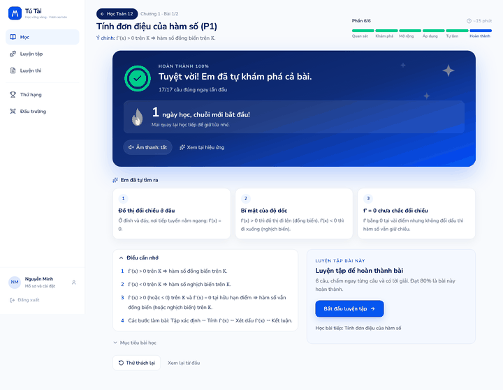 |  |

### Màn hoàn thành, điện thoại 390 (toàn trang)

| Trước (2.007 px) | Sau (1.220 px) |
| --- | --- |
|  | 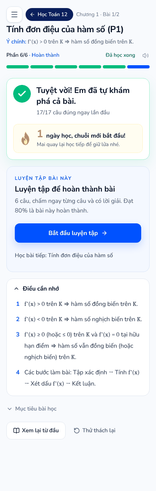 |

### Mở lại bài đã học, desktop 1440

| Trước | Sau |
| --- | --- |
| 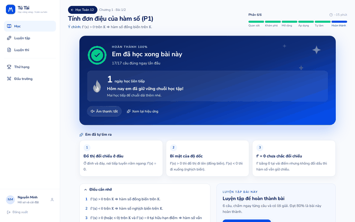 | 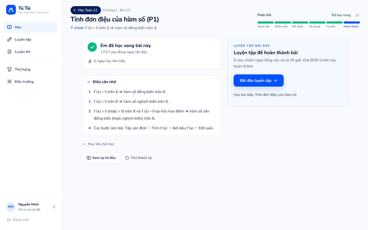 |

### Mở lại bài đã học, điện thoại 390 (toàn trang)

| Trước (2.005 px) | Sau (1.135 px) |
| --- | --- |
| 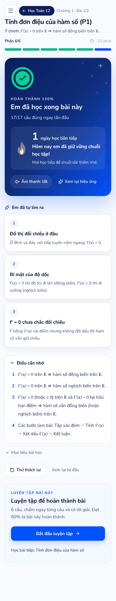 | 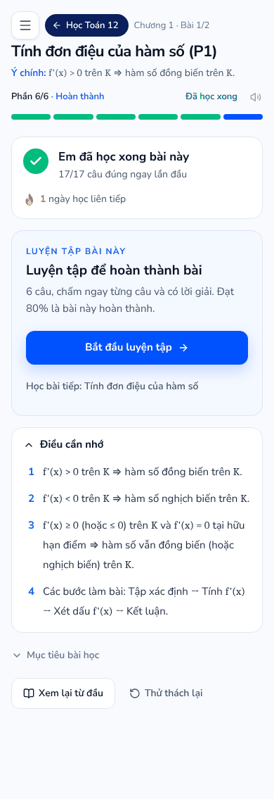 |

### Phần Áp dụng sau khi giải xong, desktop 1440 (toàn trang)

| Trước (2.027 px) | Sau (1.779 px) |
| --- | --- |
| 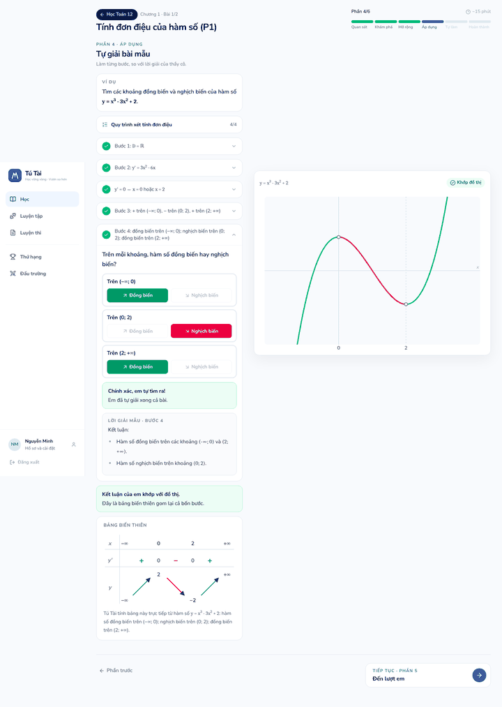 | 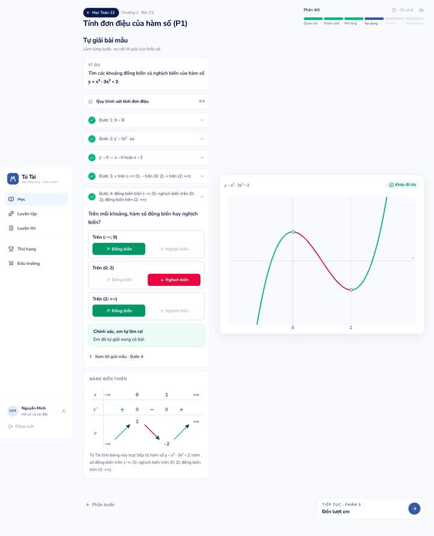 |

### Phần Quan sát

| Trước 1440 | Sau 1440 |
| --- | --- |
| 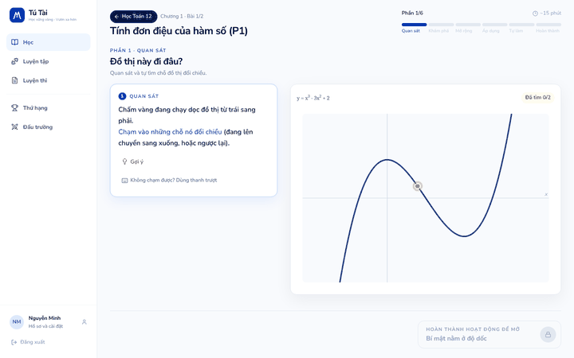 |  |

| Trước 390 | Sau 390 |
| --- | --- |
| 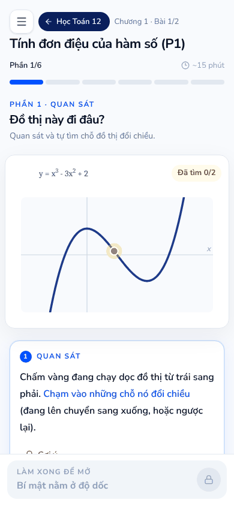 |  |

## 5. Ảnh desktop (1440×900)

| # | Màn | Ảnh |
| --- | --- | --- |
| 01 | Lộ trình học | 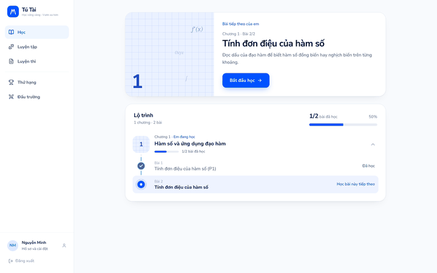 |
| 02 | Quan sát | 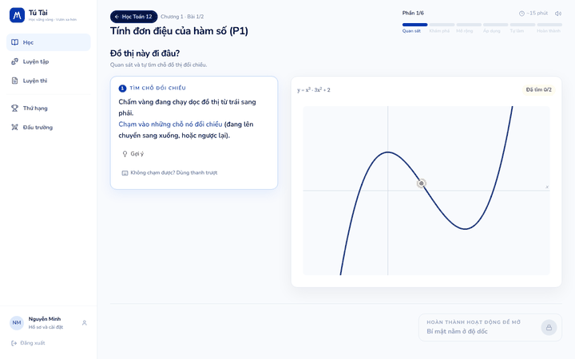 |
| 03 | Khám phá (sau khi làm xong) | 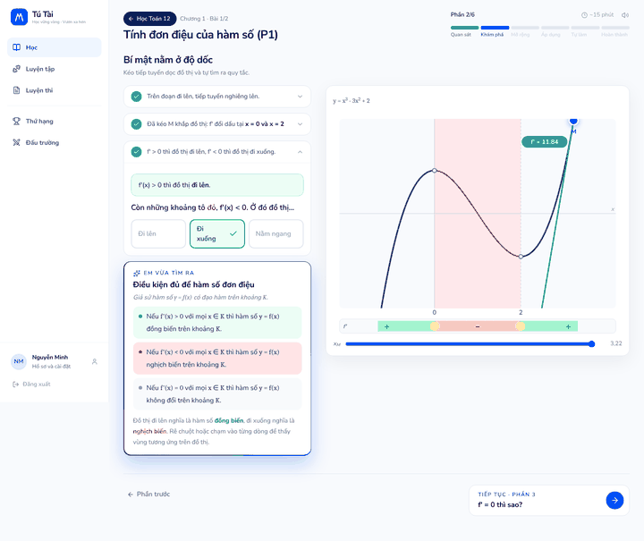 |
| 04 | Mở rộng (sau khi làm xong) | 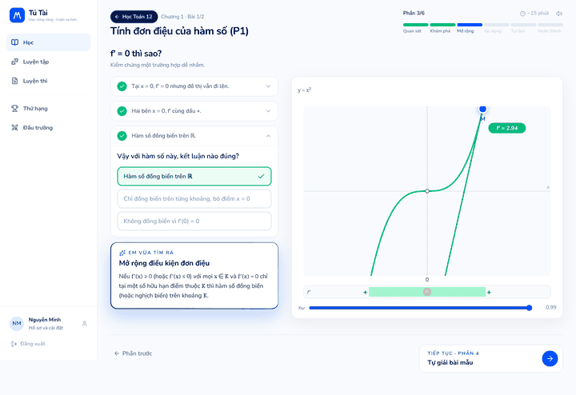 |
| 05 | Áp dụng (sau khi giải xong) |  |
| 06 | Tự làm (sau khi giải xong) | 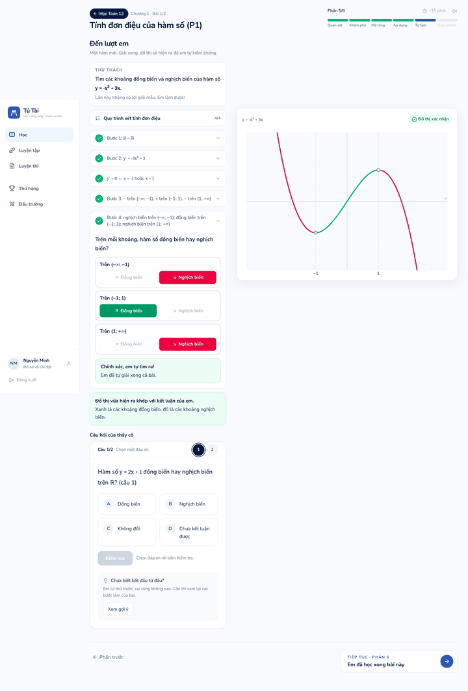 |
| 07 | Ăn mừng lần đầu (0,5 giây sau khi vào) | 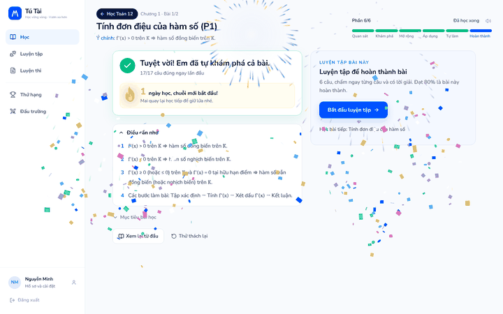 |
| 08 | Tổng kết ổn định (4 giây sau) | 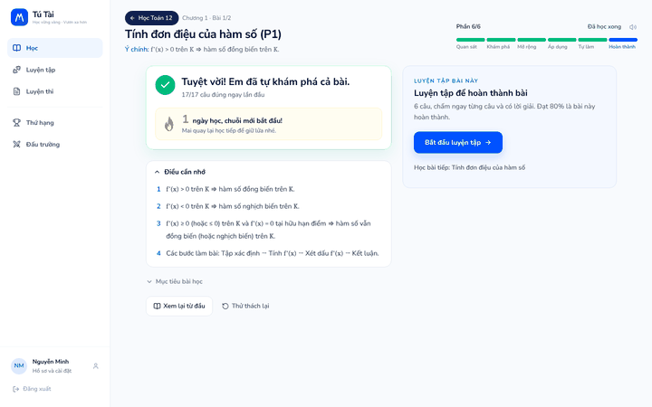 |
| 09 | Mở lại bài đã học |  |
| 10 | Luyện tập của bài | 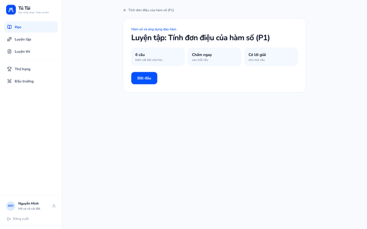 |

Ăn mừng lần đầu, ảnh động (khoảng 4 giây, chụp từng khung bằng Playwright):

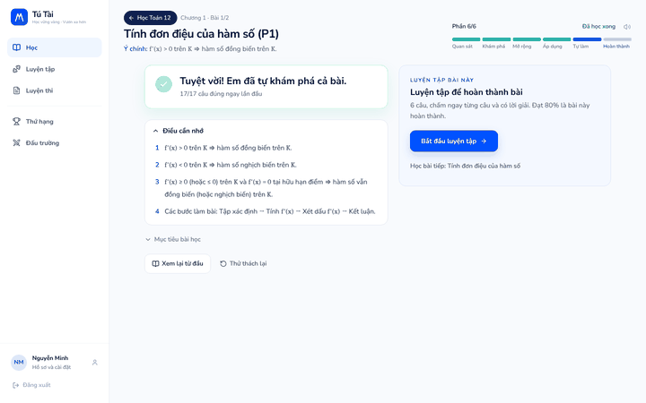

Các cỡ khác: 1920×1080 ([tổng kết](anh/kich-thuoc/1920-tong-ket.png), [Khám phá](anh/kich-thuoc/1920-kham-pha.png)), 360×640 ([Khám phá](anh/kich-thuoc/360-kham-pha.png), [tổng kết](anh/kich-thuoc/360-tong-ket.png), [bài đã học](anh/kich-thuoc/360-xem-lai.png)).

## 6. Ảnh điện thoại (390×844)

| # | Màn | Ảnh |
| --- | --- | --- |
| 11 | Lộ trình học | 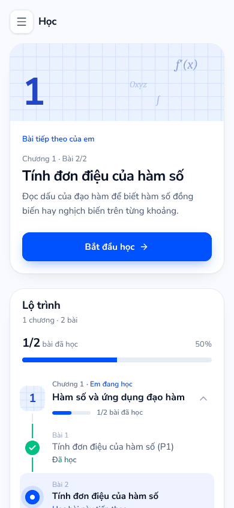 |
| 12 | Quan sát | 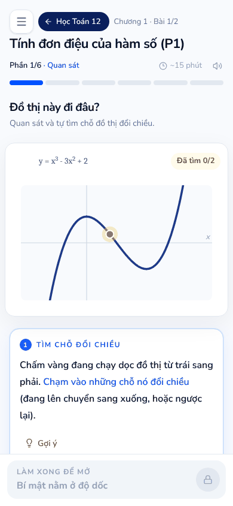 |
| 13 | Khám phá (kéo điểm M bằng cảm ứng) | 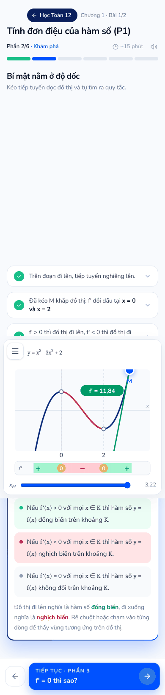 |
| 14 | Tự làm | 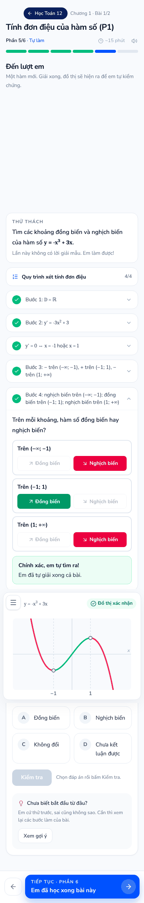 |
| 15 | Tổng kết sau khi hoàn thành |  |
| 16 | Mở lại bài đã học |  |

Ảnh toàn trang có thanh bên và đồ thị "ghim" vẽ lệch chỗ: đó là cách Playwright ghép ảnh toàn trang với phần tử `sticky`/`fixed`, không phải lỗi giao diện.

## 7. Hành vi khi hoàn thành

| Tình huống | Pháo hoa | Chuông hoàn thành | Hiển thị |
| --- | --- | --- | --- |
| Hoàn thành lần đầu | 1 lần | 1 lần (+1 tiếng chuỗi ngày nếu server xác nhận ngày mới) | "Tuyệt vời! Em đã tự khám phá cả bài." |
| Quay lại một phần rồi về Hoàn thành | không | không | tổng kết, không hiệu ứng |
| Tải lại trang | không | không | "Em đã học xong bài này" (yên lặng) |
| Về lộ trình rồi mở lại bài | không | không | yên lặng |
| Xem lại từng phần, "Xem lại từ đầu" | không | không | các phần mở ở chế độ ôn, nút Tiếp tục mở sẵn |
| Đi luyện tập rồi quay lại | không | không | thẻ đổi thành "Luyện tiếp" |
| Đã tắt âm thanh | 1 lần | không | |
| Giảm chuyển động | không | 1 lần | |
| Trình duyệt chặn phát âm thanh | 1 lần | không phát, không báo lỗi | (bấm "Tiếp tục" là một cú bấm nên thường được phép) |

Đếm bằng script gắn vào trang (`HTMLMediaElement.play` và canvas pháo hoa), không đoán bằng mắt.

Tiến độ: lưu như cũ (`tutai:lesson-progress:<id>`), không đổi định dạng. E2E so sánh chuỗi tiến độ trước và sau khi tải lại, mở lại, xem lại, luyện tập: giống hệt. Server ghi đúng 1 ngày học cho bài.

## 8. E2E QA

Môi trường: CSDL QA cục bộ `pp_lesson` (bản sao cấu trúc Toán 12 như Production và bài P1 từ bản chụp), server `next start` bản build của nhánh, `TUTAI_LEARNING_STREAK=on`. Kịch bản: `e2e/e2e-lesson.mjs` và `e2e/lesson-walk.mjs` (cần các tiện ích QA cục bộ `lib.mjs` không đưa vào repo; chỉ chạy với CSDL `pp_*`).

| Kịch bản | 1440×900 | 1920×1080 | 390×844 | 360×640 |
| --- | --- | --- | --- | --- |
| A1 Bài chưa xuất bản không mở được | PASS 2/2 | PASS 2/2 | PASS 2/2 | PASS 2/2 |
| A2 Admin xuất bản bài qua Admin UI, thêm một bài nháp | PASS 5/5 | PASS 5/5 | PASS 5/5 | PASS 5/5 |
| A3 Học sinh thấy bài vừa xuất bản, bài nháp vẫn ẩn | PASS 3/3 | PASS 3/3 | PASS 3/3 | PASS 3/3 |
| S1 Từ lộ trình mở bài và học đủ 6 phần | PASS 22/22 | PASS 22/22 | PASS 22/22 | PASS 22/22 |
| S2 Lần đầu hoàn thành: ăn mừng và âm thanh đúng một lần | PASS 11/11 | PASS 11/11 | PASS 11/11 | PASS 11/11 |
| S3 Quay lại một phần rồi về cuối: không ăn mừng lại | PASS 4/4 | PASS 4/4 | PASS 4/4 | PASS 4/4 |
| S4 Tải lại trang: trạng thái đã học, không hiệu ứng | PASS 5/5 | PASS 5/5 | PASS 5/5 | PASS 5/5 |
| S5 Về lộ trình rồi mở lại bài | PASS 3/3 | PASS 3/3 | PASS 3/3 | PASS 3/3 |
| S6 Xem lại các phần | PASS 8/8 | PASS 8/8 | PASS 8/8 | PASS 8/8 |
| S7 Luyện tập từ bài học và tiếp tục | PASS 4/4 | PASS 4/4 | PASS 4/4 | PASS 4/4 |
| S8 Tiến độ được giữ nguyên | PASS 3/3 | PASS 3/3 | PASS 3/3 | PASS 3/3 |
| V Âm thanh đã tắt | PASS 2/2 | NOT TESTED | PASS 2/2 | NOT TESTED |
| V Giảm chuyển động | PASS 1/1 | NOT TESTED | PASS 1/1 | NOT TESTED |
| **Tổng** | **73/73** | **70/70** | **73/73** | **70/70** |

Tổng cộng **286/286 PASS**. Biến thể âm thanh tắt và giảm chuyển động chạy ở 1440 và 390; ở 1920 và 360 ghi NOT TESTED. Kết quả từng kiểm tra: `e2e/ket-qua-*.json`.

Kiểm tra đầu vào:

- **A1:** bài P1 để ở trạng thái nháp. Học sinh mở đường dẫn bài thì không vào được, lộ trình không có bài.
- **A2:** Admin vào Admin › Kiến thức, mở "Soạn bài học" của P1, bấm "Lưu và hiển thị cho học sinh". Nội dung bài (đồ thị `y = x^3 - 3x^2 + 2`) giữ nguyên sau khi lưu. Admin thêm một bài mới cùng chương, "Lưu bản nháp".
- **A3:** học sinh thấy P1 trên lộ trình. Bài nháp không xuất hiện và đường dẫn trực tiếp không mở.

Sau đó: S1 học đủ 6 phần từ lộ trình; S2 ăn mừng một lần; S3 quay lại rồi về cuối; S4 tải lại; S5 về lộ trình và mở lại; S6 xem lại từng phần; S7 luyện tập rồi tiếp tục; S8 tiến độ và ngày học. Biến thể (1440, 390): âm thanh đã tắt, giảm chuyển động.

**NOT TESTED / BLOCKED**

- **Production:** xem bài P1 trên Production cần một tài khoản học sinh, tức là ghi vào Production. Không làm. Dùng bản chụp nội dung P1 từ Production.
- **Cài đặt `TUTAI_LEARNING_STREAK` trên Production:** không đọc được biến môi trường Vercel (công cụ bị từ chối quyền). QA bật cờ này; nếu Production tắt, thẻ tổng kết chỉ không có dòng chuỗi ngày.
- **Âm thanh trên thiết bị thật (Safari iOS, loa):** Playwright chỉ xác nhận lệnh phát được gọi đúng số lần, không nghe được.
- **Preview Vercel:** chưa có link preview tại thời điểm viết; xem mục 10.

## 9. Kiểm tra kỹ thuật

| Kiểm tra | Kết quả |
| --- | --- |
| `tsc --noEmit` | PASS |
| `eslint` trên các file đổi | PASS |
| `vitest` | 834 PASS, 5 FAIL có sẵn trên `master` (4 ở `features/roadmap/lib`, 1 phụ thuộc ngày ở `student-experience-service`), không liên quan |
| Test mới `lib/learning/lesson-celebration.test.ts` | 9/9 PASS |
| `next build` | PASS |
| Lỗi console trong E2E | 0 |
| Tràn ngang (6 phần × 4 cỡ) | 0 |

## 10. Pull Request

- Nhánh: `feature/lesson-focus`
- Commit: COMMIT_SHA
- PR: PR_URL (nháp)
- Preview: Vercel tạo preview cho PR; link xem trong mục Checks của PR.

Cách xem:

1. Mở preview, đăng nhập một tài khoản học sinh thử (không dùng tài khoản học sinh thật).
2. Học → mở "Tính đơn điệu của hàm số (P1)", làm đủ 5 phần, bấm "Tiếp tục" sang Hoàn thành: pháo hoa và chuông một lần.
3. Bấm ô "Quan sát" trên thanh tiến độ rồi bấm lại ô "Hoàn thành": không có gì chạy lại.
4. Tải lại trang: thẻ "Em đã học xong bài này", không pháo hoa, không âm thanh.
5. Thử biểu tượng loa ở góc trên phải: tắt rồi làm một bài khác.

Không merge, không deploy, không promote preview khi chưa có phê duyệt của chủ sản phẩm.
